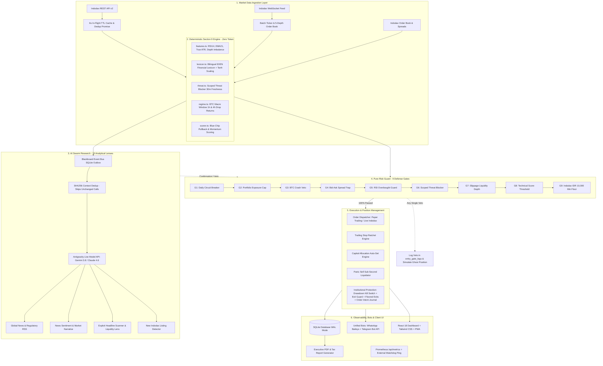
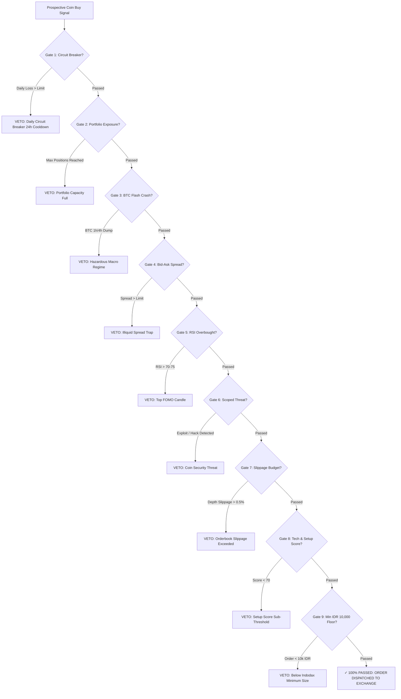

# 🚀 AI Trading Terminal — Autonomous Spot Trading & Multi-Agent Swarm for Indodax


<div align="center">

[](README.md)
[](docs/PANDUAN_PENGGUNA.md)
[-10b981?style=for-the-badge&logo=jest)](tests/)
[](https://www.typescriptlang.org/)
[](https://nodejs.org/)
[](client/)
[](https://indodax.com)
[](client/src/components/BotsView.tsx)
[](src/services/auth/)
[](LICENSE)

**Unified Autonomous Cryptocurrency Spot Trading Platform for Indodax Exchange**  
*Unifying High-Speed Deterministic Section 9 Signals (0 Token Cost), 10 Specialized AI Research Sub-Agents, a 9-Gate Pure Risk Guard Pipeline wrapped in an Institutional Protection Layer (drawdown kill switch, exit guard, floored exits, order-intent crash recovery), and Unified Remote Bots via WhatsApp &amp; Telegram.*

[Key Features](#-key-features--advantages) • [System Architecture](#-end-to-end-system-architecture) • [9 Risk Gates Pipeline](#-pure-risk-guard-9-sequential-defense-gates) • [AI Swarm Research](#-multi-agent-ai-research-swarm-10-analytical-lenses) • [Quickstart Guide](#-quickstart-guide-1-click-launchers) • [Remote Bots](#-unified-remote-bots-whatsapp--telegram) • [Capital Auto-Set](#-intelligent-capital-allocation-auto-set-engine)

</div>

---

## 📑 Table of Contents

- [1. Executive Summary & Design Philosophy](#-executive-summary--design-philosophy)
- [2. Key Features & Advantages](#-key-features--advantages)
- [3. End-to-End System Architecture](#-end-to-end-system-architecture)
- [4. Deterministic Section 9 Signal Engine](#-deterministic-section-9-signal-engine)
- [5. Pure Risk Guard: 9 Sequential Defense Gates](#-pure-risk-guard-9-sequential-defense-gates)
- [6. Multi-Agent AI Research Swarm (10 Analytical Lenses)](#-multi-agent-ai-research-swarm-10-analytical-lenses)
- [7. Counterfactual A/B Testing & Ghost Position Engine](#-counterfactual-ab-testing--ghost-position-engine)
- [8. Intelligent Capital Allocation (Auto-Set Engine)](#-intelligent-capital-allocation-auto-set-engine)
- [9. Investment Risk Profiles (Conservative, Balanced, Aggressive)](#-investment-risk-profiles)
- [10. Simulation Mode (Paper) vs Real Mode (Live Indodax)](#-simulation-mode-paper-vs-real-mode-live-indodax)
- [11. Unified Remote Bots: WhatsApp & Telegram](#-unified-remote-bots-whatsapp--telegram)
- [12. Zero-Trust Security & Resilient Infrastructure](#-zero-trust-security--resilient-infrastructure)
- [13. Quickstart Guide: 1-Click Launchers](#-quickstart-guide-1-click-launchers)
- [14. Production Deployment via Docker](#-production-deployment-via-docker)
- [15. Project Directory Architecture](#-project-directory-architecture)
- [16. Quality Assurance & Test Suite (177/177 Passing)](#-quality-assurance--test-suite)
- [17. Frequently Asked Questions (FAQ) & Troubleshooting](#-frequently-asked-questions-faq--troubleshooting)
- [18. Financial Risk Disclaimer](#-financial-risk-disclaimer)

---

## 💡 Executive Summary & Design Philosophy

Manual cryptocurrency trading is frequently plagued by emotional exhaustion, psychological biases (**FOMO** at market tops and **Panic Selling** at local bottoms), and the human inability to continuously monitor hundreds of trading pairs across 24/7 market cycles.

**AI Trading Terminal** is engineered around one foundational principle:
> 🛡️ **"Capital Preservation First, Profit Generation Second"**  
> *It is significantly better to miss a speculative entry than to suffer an irrecoverable drawdown on a careless trade.*

### Why AI Trading Terminal is Different:
1. **Decoupled Quantitative Architecture:** Large Language Models (LLMs) excel at processing global news and qualitative sentiment, but are far too slow, expensive, and unpredictable for high-frequency price analysis. We decouple these responsibilities:
   - **Deterministic Section 9:** Calculates pure mathematical technical indicators (Wilder's RSI, EMA, True ATR, Depth Imbalance) in **< 2 milliseconds** with **zero token cost** (`0 Token Cost`).
   - **AI Research Swarm:** Operates in the background analyzing macro narratives and exploit headlines from CoinDesk/CoinTelegraph/Indodax Blog RSS plus live Indodax tickers, using SHA-256 context deduplication to skip AI calls when the news and market fingerprint is unchanged.
2. **9 Pure Risk Defense Gates + Institutional Protection Layer:** Every prospective buy signal **must pass 100% of all 9 sequential safety gates** before any order is submitted to Indodax — and every open position stays wrapped in a drawdown kill switch, an exit guard, and floored limit exits that can never fill below the stop level.
3. **Mathematical Trailing Stop Ratchet:** As an asset's market price increases, profit protection thresholds are monotonically ratcheted upward and **locked one-way**. If the trend abruptly reverses, the bot immediately locks in accumulated gains.
4. **Zero-Configuration 1-Click Launchers:** Pre-packaged scripts for Windows (`start.bat`), PowerShell (`start.ps1`), and Linux/macOS (`start.sh`), accompanied by full bidirectional remote control via WhatsApp and Telegram.

---

## ✨ Key Features & Advantages

| Category | Highlighted Capability | Architectural Impact & Benefits |
| :--- | :--- | :--- |
| **Speed & Efficiency** | **Section 9 Engine** | Pure mathematical signal pipeline, sub-millisecond execution, 0 token expenditure. |
| **Market Intelligence** | **10 AI Sub-Agents** | Ten analytical lenses over verified inputs: CoinDesk/CoinTelegraph/Indodax Blog RSS, Indodax tickers, and a deterministic threat scanner. No Twitter/X, Reddit, or on-chain scraping is claimed. |
| **Capital Defense** | **9 Risk Defense Gates + Institutional Protection Layer** | Daily circuit breaker, bid-ask spread trap filter, anti-FOMO RSI guard, and BTC flash crash veto — wrapped in a drawdown kill switch, exit guard, and floored exit execution. |
| **Financial Sizing** | **Capital Auto-Set** | Intelligent dynamic position sizing scaled to available balance (from micro IDR 10,000 up to tens of millions), with an optional max-allocation-per-trade cap as a percentage of current equity. |
| **Profit Locking** | **Trailing Ratchet** | Dynamic monotonic stop-loss escalation prevents open profits from turning into catastrophic losses. Live exits use **floored limit orders** so they can never fill below the stop level. |
| **UI Observability** | **Entry Diagnostics** | Transparent live observability table explaining why coins were approved or vetoed at each gate. |
| **Ops Observability** | **Prometheus Metrics & Watchdog** | `GET /api/metrics` exposition (positions, drawdown state, pending order intents, loop latency), structured pino logging, and an external uptime-watchdog ping (`WATCHDOG_URL`). |
| **Remote Control** | **Unified Bots View** | Centralized bot management for WhatsApp & Telegram with 4 modes: *Both*, *WhatsApp Only*, *Telegram Only*, or *Disabled*. Conversational AI actions are guarded by a two-step confirmation code. |
| **Zero-Trust Security** | **Admin Access Token** | Constant-time token verification (`crypto.timingSafeEqual`) with automated background rotation schedules. |
| **AI Validation** | **A/B Ghost Positions** | Real-time counterfactual simulation benchmarking AI vetoes against market prices to compute empirical AI Alpha. |
| **Strategy Research** | **Portfolio Backtest & Walk-Forward** | Multi-symbol backtester with concurrent position slots and a shared cash pool, a 90-day local candle cache, and walk-forward optimization with an explicit OVERFIT verdict. |
| **Internationalization** | **Multi-Language (i18n)** | Full bilingual English (default) and Indonesian support across UI, tables, and reporting. |
| **Portability** | **PWA & Offline Shell** | Installable Progressive Web App (PWA) with responsive mobile layouts and modern dark mode styling. |

---

## 🏛️ End-to-End System Architecture

Below is the comprehensive architectural blueprint of the **AI Trading Terminal**:


### End-to-End System Data Flow:


---

## ⚡ Deterministic Section 9 Signal Engine

Unlike conventional cryptocurrency bots that exhaust costly LLM tokens on every price tick, AI Trading Terminal utilizes the **Deterministic Section 9 Pipeline** located in [`src/services/signals/`](src/services/signals/). This pipeline executes directly in local system memory:

1. **Quantitative Feature Extraction ([`features.ts`](src/services/signals/features.ts)):**
   - **RSI(14) with Wilder's Smoothing:** Calculates momentum across candles with zero drift.
   - **Exponential Moving Average (EMA 21):** Evaluates trend alignment and dynamic support floors.
   - **True Average True Range (True ATR):** Captures true volatility by incorporating candle gap wicks.
   - **Depth Imbalance:** Analyzes bid-wall versus ask-wall pressure across the top 5 levels of the Indodax orderbook.
   - **Bid-Ask Spread Analysis:** Calculates real-time spread percentages to ensure fair execution.
2. **Bilingual Financial Sentiment Lexicon ([`lexicon.ts`](src/services/signals/lexicon.ts)):**
   - Curated dictionary of hundreds of financial terms in both English and Indonesian (*surge, partnership, hack, lawsuit, delisting, exploit*).
   - Utilizes the **Hyperbolic Tangent (`tanh`)** scaling function to strictly bound sentiment values between `[-1.0, +1.0]`.
   - Applies a **48-Hour Age Decay Curve**: Fresh news carries maximum weight, while older reports exponentially decay.
3. **Scoped Threat Blocker ([`threat.ts`](src/services/signals/threat.ts)):**
   - Scopes security threats per individual coin symbol. A security scare on an obscure token will never freeze entries for Bitcoin or Ethereum.
   - Discards common benign substrings such as `"sec"` (seconds) or `"second"`.
   - Features a **30-Minute Freshness Window**, ensuring markets do not remain permanently blocked after false alarms clear.
4. **BTC Macro Regime Window Returns ([`regime.ts`](src/services/signals/regime.ts)):**
   - Tracks Bitcoin price velocity across rolling **1-hour (`<= -3%`)** and **4-hour (`<= -5%`)** windows.
   - Accurately detects acute flash dumps without interrupting trades during normal sideways consolidations.
5. **Conservative Blue-Chip Pullback Scorer ([`scorer.ts`](src/services/signals/scorer.ts)):**
   - Enables Conservative profiles to safely capture high-cap assets (BTC, ETH, SOL) during healthy pullbacks to the EMA21 support line when RSI is in cool territory (< 48).

---

## 🛡️ Pure Risk Guard (9 Sequential Defense Gates)

Every prospective trade signal must sequentially pass the rigorous **9 Defense Gates** in [`src/services/trading/riskGuard.ts`](src/services/trading/riskGuard.ts):




### Gate-by-Gate Specification:
1. **Gate 1 — Daily Circuit Breaker:** Sums total realized losses for the day. If losses exceed the risk profile limit (e.g., 5%), auto-trading is immediately halted for 24 hours. Employs decoupled state ratcheting to prevent execution deadlocks.
2. **Gate 2 — Portfolio Exposure Limit:** Enforces concurrency limits on active positions (1 to 5 coins based on risk profile and balance tier).
3. **Gate 3 — BTC Macro Regime:** Vetoes all buy entries across the board if Bitcoin experiences an acute flash dump (> 3% drop in 1 hour or > 5% in 4 hours).
4. **Gate 4 — Spread Trap Guard:** Rejects assets with excessive bid-ask spreads (> 0.8% - 1.5%), safeguarding capital against illiquid traps.
5. **Gate 5 — RSI Guard (Anti-Top FOMO):** Prevents entering tokens whose 14-period RSI is already overbought (> 70-75).
6. **Gate 6 — Scoped Threat Scoping:** Confirms the specific target coin has had zero exploit disclosures, contract hacks, or delisting announcements within the past 30 minutes.
7. **Gate 7 — Slippage Budget:** Simulates full order execution against the top 5 levels of the Indodax orderbook, ensuring effective slippage does not exceed 0.5%.
8. **Gate 8 — Technical Score Threshold:** Mandates that the composite technical setup score meets or exceeds the required threshold (default 70/100).
9. **Gate 9 — Indodax Minimum Floor:** Verifies that after subtracting cash reserves, the net order value is **at least IDR 10,000**, fully satisfying Indodax exchange regulations.

### Institutional Protection Layer (wraps the 9 gates)

The 9 gates decide *whether to enter*. A second, independent layer protects capital *around and after* every entry — critical because the Indodax Trade API v2 cannot host stop orders (`STOP_LIMIT` is rejected by `POST /api/v2/order`; verified against the official docs), so downside protection lives in this process:

1. **Drawdown Kill Switch:** Tracks the mode-scoped equity peak. If equity falls `max_drawdown_percent` (default 15%) below its peak, or below the absolute `equity_floor_idr`, auto-trading halts and the configured de-risk mode runs: `halt` (entries only), `halve` (sell 50% of every position), or `flatten` (liquidate all). There is **no automatic reset** — clearing it requires the manual `POST /api/trading/drawdown-reset` endpoint (or the Dashboard protection card), which re-bases the equity peak.
2. **Exit Guard:** While any live position lacks a guaranteed exit plan (dust remainder below the exchange minimum, a sell failure, or balance ambiguity), new live entries are refused (`require_protective_orders=1`). Flags clear automatically after a clean reconciliation.
3. **Floored Limit Exits:** Live sells first place a `LIMIT SELL` at the trailing-stop level (or collar price), so they can never fill below the floor; the unfilled remainder is cancelled and market-sold after `limit_exit_timeout_ms`. A remainder too small for the exchange minimum is flagged for manual review instead of retrying forever.
4. **Order-Intent Journal & Crash Recovery:** Every live order is journaled in `order_intents` with an official `newClientOrderId` **before** the request leaves the process. After a crash between "order sent" and "fill recorded", the engine recovers the truth by querying the exchange with `origClientOrderId`; critical findings pause auto-trading and alert the admin.
5. **Resilient API access:** Private GET/DELETE calls retry with exponential backoff honoring `Retry-After` (POSTs are never blindly retried — order intents cover crash recovery instead), and account reads are deduplicated to respect rate limits.
6. **Shutdown warning:** If the process stops while live positions are open, admins receive a WhatsApp/Telegram warning that exit protection is offline until restart.

---

## 🤖 Multi-Agent AI Research Swarm (10 Analytical Lenses)

Located in the **AI Research** tab, 10 analytical lenses in [`src/services/agents/`](src/services/agents/) run on the same grounded context:

- **News:** CoinDesk RSS, CoinTelegraph RSS, and Indodax Blog RSS (5-minute cache).
- **Market:** Indodax public tickers, top gainers, 24h volume, top-of-book spreads, and BTC reference prices.
- **Deterministic context:** headline sentiment lexicon and a threat keyword scanner.
- **Optional feeds:** set `AI_TRADING_EXTRA_RSS_FEEDS` to add up to 5 public RSS URLs (for example a Reddit RSS feed). No direct Twitter/X, on-chain wallet, CoinGecko, The Fed, Bank Indonesia, or Bappebti feed is integrated by default.

1. **Global News Analyst:** Summarizes breaking crypto headlines from CoinDesk and CoinTelegraph RSS.
2. **Tech & Ecosystem Analyst:** Screens the same headlines for protocol upgrades, hard forks, and ecosystem news.
3. **News Sentiment Analyst:** Compares deterministic lexicon scores of headlines with Indodax market moves.
4. **Market Narrative Radar:** Identifies dominant narratives across headlines, Indodax Blog, and tickers.
5. **Indodax Listing Radar:** Reads the official Indodax Blog and new-coin alerts; no direct exchange announcement API beyond those sources.
6. **Momentum Hunter:** Analyzes Indodax top gainers and 24h volume.
7. **Security Radar:** Screens headlines for hack/exploit/delisting keywords. This is not a smart-contract audit.
8. **Macro & Regulatory Radar:** Highlights macro/regulatory headlines available in RSS; it does not have direct central-bank or regulator feeds.
9. **Liquidity & Spread Analyst:** Reviews top-of-book bid/ask spreads and volume on Indodax.
10. **BTC Correlation Analyst:** Compares BTC direction with top altcoin gainers on Indodax.

### Token Optimization & Failure Policy
- **SHA-256 Fingerprint Deduplication:** Generates cryptographic hashes of news headlines and market state. If the context has not fundamentally changed, AI calls are **automatically skipped** (`skipped_dedup`). Actual token savings depend on how frequently the underlying news and market context changes.
- **Compact Payload Formatting:** System prompts are minimized into single-line JSON structures with redundant whitespace eliminated.
- **Mode-aware fail-closed policy:** In paper `confirm` mode, a failed AI confirmation can fall back to deterministic signals for simulation. In **live mode** (and every `required` mode), AI failure blocks new entries until the provider recovers; open positions continue to be monitored by the exit engine.

### Portfolio Advisor, Prompt Versioning & Self-Learning
- **Portfolio Advisor (read-only):** A daily review role that inspects open positions, equity, 7-day performance, and the BTC regime, then publishes up to 3 advisory recommendations to the AI Research tab. It **cannot execute anything** — the output is advisory text only.
- **Versioned prompts (`src/services/ai/prompts.ts`):** Every LLM role's prompt carries an explicit version, recorded per call in `ai_call_logs.prompt_version` for a full audit trail. Any behavior-affecting wording change requires a version bump.
- **Eval harness:** `tests/ai_evals.test.ts` pins prompt invariants (JSON-only verdict format, risk budget present, read-only constraints, confirmation policy), and `npm run ai:eval` runs a golden-scenario set against a real model to measure verdict agreement after any prompt change.
- **Weekly learning report:** A 7-day digest (win rate, net PnL, profit factor, top post-mortem lessons) is sent to the admin bots. Post-mortem lessons are enriched with the BTC regime they were taken in, and condition future entry prompts.

---

## 🔬 Counterfactual A/B Testing & Ghost Position Engine

How do you verify whether AI vetoes genuinely protect capital rather than discard lucrative opportunities?

AI Trading Terminal includes a built-in **A/B Counterfactual Testing Engine**:
- Whenever the AI swarm or risk gates veto a prospective buy signal, a virtual **Ghost Position** is registered in the database table [`ghost_positions`](src/db/index.ts).
- The system monitors this shadow position against real-time Indodax market prices as if the trade had actually executed.
- Outcomes are categorized into empirical performance groups:
  - 🛡️ **`BULLET_DODGED`:** The vetoed trade subsequently collapsed or hit the virtual stop-loss, indicating the veto avoided a loss in that sample.
  - ⚠️ **`MISSED_OPPORTUNITY`:** The vetoed trade subsequently met the take-profit target.
  - ⚖️ **`NEUTRAL`:** The vetoed trade broke even within the tracking window.
- The dashboard reports a counterfactual **AI Alpha** estimate: the simulated net percentage of portfolio capital that vetoed trades would have gained or lost.

---

## 💰 Intelligent Capital Allocation (Auto-Set Engine)

The **Capital Allocation Auto-Set Engine** in [`src/services/trading/index.ts`](src/services/trading/index.ts) dynamically sizes trades based on available wallet balance:


### Dynamic Capital Allocation Matrix:

| Balance Bracket (IDR) | Tier Classification | Maximum Positions | Allocation per Position | Safety Cash Reserve | Operational Behavior |
| :--- | :--- | :---: | :---: | :---: | :--- |
| **< IDR 100,000** | **Micro** | **1 Coin** | Single allocation | 15% | Guarantees orders remain strictly above the **IDR 10,000** exchange floor. |
| **IDR 100k - 1M** | **Small** | **2 - 3 Coins** | 28% - 42.5% | 15% | Balanced split between core assets and top momentum setups. |
| **IDR 1M - 10M** | **Medium** | **3 - 5 Coins** | 17% - 28% | 15% - 20% | Full multi-coin diversification with deep orderbook slippage budgeting. |
| **> IDR 10,000,000** | **Large** | **5 Coins** | Risk-adjusted | 20% - 25% | Prioritizes deep liquidity pools and EMA21 structural support pullbacks. |

> 💡 **Instant Remote Adjustment:** Capital limits and risk profiles can be updated on the fly via the Web Dashboard or by messaging the bot: `/capital 500000 moderate`.

---

## 🎯 Investment Risk Profiles

Tailor the bot's execution style with a single click in **Settings &rarr; Risk Profile**:


| Strategy Parameter | 🛡️ Conservative | ⚖️ Moderate *(Recommended)* | 🚀 Aggressive |
| :--- | :--- | :--- | :--- |
| **Take Profit Target (TP)** | 3.5% | 5.0% | 7.5% |
| **Trailing Stop Ratchet** | 1.8% (Tight) | 2.5% (Balanced) | 3.5% (Wide) |
| **Simultaneous Positions** | Maximum 2 Coins | Maximum 3 Coins | Maximum 5 Coins |
| **Asset Universe** | Tier 1 Blue-Chips (BTC, ETH, SOL) | Top 20 Indodax Liquidity | Momentum Breakouts & New Listings |
| **Daily Circuit Breaker** | 3.0% Maximum Loss | 5.0% Maximum Loss | 7.0% Maximum Loss |
| **Target Trader Persona** | Capital preservation & beginners | Standard balanced crypto traders | High-conviction traders in Bull Runs |

---

## 🔄 Simulation Mode (Paper) vs Real Mode (Live Indodax)

### 1. Demo Mode (Paper Trading) — Zero Financial Risk
- Pre-loaded with **IDR 10,000,000** in virtual trading capital.
- Streams real live market prices directly from the Indodax exchange.
- Accurately simulates buy orders, exchange taker fees (configurable via `trading_fee_percent`, default 0.3322% all-in for Indodax IDR market orders), orderbook slippage, and trailing stop exits.
- Recommended for testing and calibration for 3 to 7 days before funding real capital.

### 2. Live Mode (Real Indodax Funds) — Real Capital Execution
- Direct integration with your Indodax account via API Key and Secret Key.
- Protected by an interactive **3-Point Safety Confirmation Modal** before activation.
- Orders are executed live on the official Indodax orderbook.
- Includes a **Panic Sell Button (< 1 Second)** to immediately liquidate all open crypto assets to IDR in global emergencies.

**Live safety behavior (read before funding):**
- **Every order is fill-verified.** The engine polls the exchange order status after submission, records the actual executed quantity and average price, and handles partial fills. If a fill cannot be confirmed, the order is cancelled where possible and the position is left for review instead of being marked closed based on an assumption.
- **Startup reconciliation runs automatically.** Before trading resumes, local open positions are compared against real balances and open exchange orders. Mismatches (missing balance, unexpected open order, stale exit claim) are reported, and auto-trading stays paused until you review them.
- **Auto-resume is opt-in and fail-safe.** Auto-trading is always paused when the server restarts. It only resumes automatically when `auto_resume_on_startup=1` is set **and** reconciliation reports a safe state; otherwise it remains paused and requires manual activation.
- **Deadman switch scope is limited.** The Indodax deadman switch (`countdownCancelAll`) can only cancel **open exchange orders** after the process stops pinging. It does **not** liquidate spot holdings and it does **not** place a stop-loss.
- **No native exchange stop-loss exists on the Indodax API.** This is an exchange limitation, verified against the official Trade API v2 docs: `POST /api/v2/order` explicitly rejects stop orders (`STOP_LIMIT` is not a supported type) — only `LIMIT` and `MARKET` can be placed. Consequently, trailing stops, take-profits, and the circuit breaker are enforced by the local engine and only run while this process is online. The engine mitigates this with: **floored limit exits** (live exits first place a `LIMIT SELL` at a price floor so they can never fill below it, then market-sell any remainder — see `exit_floor_limit_enabled`), a **max-drawdown kill switch** with equity floor and configurable de-risk (`halt`/`halve`/`flatten`), an **exit guard** that refuses to open new live positions while any live position lacks a guaranteed exit plan (`require_protective_orders`), a **shutdown warning** whenever live positions remain open, and **order-intent journaling** with `clientOrderId` crash recovery. For unattended live trading, run on an always-on VPS with automatic restart (systemd/Docker restart policy) so engine downtime stays in the seconds-to-minutes range.

---

## 📱 Unified Remote Bots: WhatsApp & Telegram

Remote control and automated notification feeds are unified inside a **single central control panel** in the **Bots** tab:


### Notification Channel Modes:
1. 🚀 **Both Channels (WhatsApp + Telegram):** Dispatches buy/sell alerts, daily profit summaries, and emergency alerts simultaneously to both apps *(Recommended)*.
2. 🟢 **WhatsApp Only:** Operates exclusively via the embedded Baileys WhatsApp Web client.
3. 🔵 **Telegram Only:** Operates via the official Telegram Bot API (Token & Chat ID).
4. 🛑 **Disable All Bots:** Silent mode; completely pauses automated notification broadcasts.

### Remote Bot Command Reference:
| Command | Permission | Description |
| :--- | :---: | :--- |
| `/status` | Public / Admin | Displays bot operational health, exchange connectivity, and open positions. |
| `/profit` | Public / Admin | Reports today's realized profit, win rate, and total net performance. |
| `/coins` | Public / Admin | Lists top 5 trending gainers on Indodax. |
| `/capital <amount> [profile]` | **Admin Only** | Dynamically reconfigures trading capital and risk profile from your phone. |
| `/start` | **Admin Only** | Resumes or enables autonomous spot trading remotely. |
| `/stop` | **Admin Only** | Pauses automated entry signal execution. |
| `/panic` | **Admin Only** | Triggers an immediate sub-second market liquidation of all open coins to IDR. |
| `/balance` | **Admin Only** | Checks available IDR cash balance and total portfolio valuation. |
| `/admin <token>` | Verification | Authorizes the sender's phone number as a registered Administrator using the access token. |
| `/help` | Public / Admin | Displays the full interactive command glossary. |

### Conversational AI Actions & Two-Step Confirmation

The WhatsApp assistant can also execute actions from free-form chat (e.g., *"beli btc 100000"*, *"matikan bot"*). Destructive actions — **RESUME_AUTOTRADING, SET_RISK_PROFILE, SET_TRADING_MODE, BUY_COIN, SELL_COIN, PANIC_SELL** — are never executed directly from the model's output:

1. The bot replies with a **6-digit confirmation code** (valid for 5 minutes).
2. The admin must reply with that exact code. The code check runs **outside the LLM**, so the model can never bypass or fabricate the second factor.
3. A wrong, expired, or missing code cancels the pending action; only `STOP_AUTOTRADING` (pausing is protective) executes immediately.

---

## 🔒 Zero-Trust Security & Resilient Infrastructure

1. **Restricted Indodax API Permissions:**
   - The bot strictly requires only `View (Read)` and `Trading (Trade)` permissions.
   - ❌ **NEVER ENABLE WITHDRAW PERMISSIONS!** Without withdrawal privileges, your funds remain securely locked inside Indodax.
2. **Zero-Trust Admin Access Token (Fail-Closed):**
   - Administrative endpoints, dashboard actions, and WebSocket admin channels require a 32-character hexadecimal token.
   - Authentication checks utilize `crypto.timingSafeEqual` to guard against side-channel timing attacks.
   - If no token is configured, admin access is denied rather than opened. Visitors without valid credentials are restricted to View-Only mode, which now hides balances, positions, trade history, WhatsApp QR/identity, and provider quota details.
   - The token is printed to the console only when the server runs on an interactive TTY. In headless/Docker logs, retrieve it locally with `npm run admin:token` (only someone with access to the server data directory can run this).
3. **Encryption at Rest ([`secrets.ts`](src/services/security/secrets.ts)):**
   - Indodax API key/secret, admin token, Telegram/ngrok tokens, WhatsApp/Telegram identifiers, and AI provider `api_keys`/OAuth tokens are encrypted with **AES-256-GCM** before being written to SQLite. Legacy plaintext rows are migrated automatically on startup.
   - The key lives at `data/.encryption-key` (mode `0600`) or comes from `AI_TRADING_ENCRYPTION_KEY`. **Back up the key separately from the database**; a copied database cannot be decrypted without it.
4. **Automated Token Rotation Service ([`tokenRotation.ts`](src/services/auth/tokenRotation.ts)):**
   - Configurable rotation policies: *Fixed*, *Rotate on Startup*, or *Periodic Schedules (e.g., every 1h, 24h)*.
5. **Isolated SQLite Database & Auto-Backup ([`backupService.ts`](src/services/backup/backupService.ts)):**
   - Runs in **WAL (Write-Ahead Logging)** mode for crash resilience and concurrency.
   - Automated timestamped database snapshots are preserved in `backups/` and can be downloaded from the Reports UI.
6. **Official Audit PDF & CSV Export:**
   - Enables one-click exports of trade histories to formatted spreadsheet **CSV** files and audit-ready **PDF Reports**.
7. **Conversational AI Action Guard:**
   - Destructive actions requested through WhatsApp free-form chat require a 6-digit two-step confirmation code that is consumed outside the LLM, with a 5-minute expiry (see [Remote Bots](#-unified-remote-bots-whatsapp--telegram)).

---

## 🚀 Quickstart Guide: 1-Click Launchers

### System Requirements:
- **Node.js:** Version **22.12.0** or newer ([Download Node.js](https://nodejs.org/)).
- **Operating System:** Windows 10/11, macOS, or Linux (Ubuntu, Debian, CentOS).
- **Network:** Stable internet connection for real-time WebSocket and REST feeds.

### Running with 1-Click Launchers:

#### 🪟 Windows:
1. Extract or clone this repository to your local drive.
2. Double-click **`start.bat`** (or right-click `start.ps1` and select *Run with PowerShell*).
3. The launcher will automatically verify dependencies, compile the application, and launch your browser at:
   ```
   http://localhost:3001
   ```

#### 🐧 Linux / macOS:
1. Open a terminal in the project directory.
2. Grant execution permissions and start the service:
   ```bash
   chmod +x start.sh
   ./start.sh
   ```
3. Open your browser and navigate to `http://localhost:3001`.

---

## 🐳 Production Deployment via Docker

To run the terminal headlessly on a Linux cloud VPS:

```bash
# 1. Copy the environment template
cp .env.example .env

# 2. Build and launch the container in detached mode
docker compose up -d --build

# 3. View live server logs (the admin token is intentionally not printed to non-interactive logs)
docker compose logs -f

# 4. Retrieve the admin token from inside the container
docker compose exec ai-trading npm run admin:token
```
Access the dashboard through your browser at `http://YOUR-SERVER-IP:3001`.

The image ships with a `HEALTHCHECK` (polls `/api/system/health`), and `docker-compose.yml` uses `restart: unless-stopped`, so a crashed process restarts automatically — keep that behavior, because exit protection lives in this process (see the [Institutional Protection Layer](#institutional-protection-layer-wraps-the-9-gates)).

### Systemd Deployment (bare-metal VPS)

Prefer running without Docker? A ready-made unit with `Restart=always` ships in [`deploy/ai-trading.service`](deploy/ai-trading.service):

```bash
sudo cp deploy/ai-trading.service /etc/systemd/system/  # edit User/WorkingDirectory first
sudo systemctl daemon-reload && sudo systemctl enable --now ai-trading
```

### Observability Environment Variables

Set these in `.env` (see `.env.example`) for professional operations:

| Variable | Effect |
| :--- | :--- |
| `AI_TRADING_STRUCTURED_LOGS=1` | Routes all console output through pino (structured JSON); plain console stays the default otherwise. |
| `LOG_LEVEL` | `error` \| `warn` \| `info` \| `debug` (default `info`). |
| `LOG_FILE` | Additionally appends logs to a file (use logrotate for rotation). |
| `WATCHDOG_URL` | External uptime ping (healthchecks.io-compatible). Pinged once per minute after successful engine loops; if the ping stops, the monitor alerts you that the bot stopped protecting positions. |
| `AI_TRADING_ENCRYPTION_KEY` | Optional 32-byte AES-256-GCM key (else generated at `data/.encryption-key`). |

Scrape `GET /api/metrics` with Prometheus for positions by mode, unprotected live positions, drawdown/circuit-breaker state, pending order intents, loop duration, and market WebSocket status — or read the same state from the Dashboard protection card.

---

## 📂 Project Directory Architecture


| Directory / Module | Path | Primary Role & Responsibilities |
| :--- | :--- | :--- |
| **Frontend Web (PWA)** | `client/` | React 18, Tailwind CSS, Vite, Lucide Icons, service worker, & PWA manifest. |
| **Internationalization** | `client/src/i18n/` | Bilingual dictionaries (`translations.ts`), context provider (`LanguageContext.tsx`), and switchers. |
| **UI Components** | `client/src/components/` | `DashboardView`, `BotsView`, `EntryDiagnosticsSection`, `QuotaView`, `ReportView`. |
| **Documentation & Assets** | `docs/` | `docs/assets/` (Vector SVGs), `PANDUAN_PENGGUNA.md` (Indonesian User Guide), and audit logs. |
| **Quantitative Signals** | `src/services/signals/` | Deterministic Section 9 (`features`, `lexicon`, `threat`, `regime`, `scorer`). |
| **Trading & Risk Guard** | `src/services/trading/` | 9 Risk Defense Gates (`riskGuard`), institutional protection layer (drawdown kill switch, exit guard, floored exits), order-intent journal, trailing ratchet, & capital auto-set engine. |
| **AI Swarm Intelligence** | `src/services/agents/` | 10 specialized intelligence analysts, read-only Portfolio Advisor, SQLite outbox Blackboard bus, & SHA-256 deduplication. |
| **AI Prompt Registry** | `src/services/ai/prompts.ts` | Versioned prompts for every LLM role with per-call version audit trail (`ai_call_logs.prompt_version`) and the `npm run ai:eval` golden-scenario harness. |
| **Research & Backtesting** | `src/services/backtest/`, `src/services/candles/`, `scripts/` | Single-symbol & portfolio backtest engines (concurrent slots, zero-lookahead stops), 90-day candle cache in SQLite, grid-search optimizer with walk-forward analysis. |
| **Indodax Market Adapter** | `src/services/indodax/` | REST v2 wrapper & WebSocket client with 6-second in-flight promise deduplication, retry/backoff on private endpoints, & write-through candle persistence. |
| **Remote Bot Services** | `src/services/whatsapp/` & `telegram/` | Baileys WhatsApp Multi-Device engine & Telegram Official Bot API integration. |
| **Security & Auth** | `src/services/auth/` | Token rotation manager & constant-time `timingSafeEqual` authentication verification. |
| **Database & Snapshots** | `src/db/` & `src/services/backup/` | SQLite WAL engine, relational schemas, migrations, and automated snapshot backup services. |
| **REST API Server** | `src/api/` & `src/server.ts` | Express REST routes, exchange webhooks, zero-trust token protection middleware, `/api/metrics` Prometheus exposition, & lifecycle hooks. |
| **Automated Test Suite** | `tests/` | 177 unit and integration tests across 45 suites, covering critical quantitative algorithms, execution safety, institutional protection, API security, and risk barriers. |
| **Process Supervision** | `deploy/ai-trading.service` | systemd unit with `Restart=always` for always-on VPS operation (seconds-to-minutes downtime). |
| **1-Click Launchers** | `start.bat`, `start.ps1`, `start.sh` | Automated zero-configuration launchers for Windows, Linux, and macOS. |
| **Containerization** | `Dockerfile`, `docker-compose.yml` | Multi-stage production Docker container configuration for continuous 24/7 cloud hosting. |

> [!NOTE]
> **Unified Full-Stack Architecture:**
> - **`src/` (Backend Core):** Executes the deterministic Section 9 signal pipeline, applies the 9 risk gates, coordinates the AI swarm, manages SQLite persistence, and drives remote WhatsApp/Telegram bots.
> - **`client/` (Frontend Dashboard):** The interactive web console available at `http://localhost:3001` — presenting candlestick charts, order controls, market scanners, quota monitors, and live gate diagnostics.
> - Both modules are bundled and served harmoniously from a single consolidated server process via the 1-click launchers (`start.bat` / `start.sh`).

---

## 🧪 Quality Assurance & Test Suite

All critical business logic, token security routines, quantitative indicators, and risk defense gates are safeguarded by **177 unit & integration tests** located in [`tests/`](tests/):

```bash
# Execute the entire automated test suite:
npm test
```

### Verified Test Suite Breakdown:
```
✔ AI failure policy (paper fallback vs. live fail-closed)
✔ Subagent source honesty & extra RSS feed validation
✔ API security, observer redaction, admin token rotation & query-token rejection
✔ Secrets at-rest encryption & fail-closed admin authentication
✔ Capital Allocation & Auto-Set Engine
✔ Quantitative indicators (RSI, EMA, True ATR) & spread mechanics
✔ Live reconciliation, fill handling, stale exit claims & auto-resume safety
✔ New-coin registry persistence across restarts
✔ Fee-aware PnL, mode-scoped equity & circuit breaker fail-closed behavior
✔ Concurrent position exit protection (full exit & partial take-profit)
✔ Performance reporting, CSV export, database backup & Telegram notifier
✔ Section 9 lexicon, scoped threat blocker, BTC regime & blue-chip scoring
✔ Pure Risk Guard execution pipeline (Gates 1–9)
✔ Swarm deduplication, blackboard outbox & MarketAdapter abstraction
✔ Signatures, slippage, quantity precision, trailing stops & fail-closed AI parsing
✔ CORS hardening, RSS sanitization, sell-failure protection & admin middleware
✔ Risk profiles, self-learning memory, backtest engine & A/B ghost positions
✔ Model discovery, WhatsApp LID authorization & conversational AI actions
✔ Circuit breaker resilience & decoupled trailing ratchet
✔ Institutional protection: floored exits, dust handling, drawdown kill switch & de-risk modes
✔ Order-intent journal crash recovery & safety-status telemetry
✔ Portfolio backtest simulator (concurrent slots, shared cash, zero-lookahead stops)
✔ Candle store round-trip & new indicators (MACD, Bollinger width, volume z-score)
✔ Prompt version invariants & AI verdict parser golden cases
---------------------------------------------------------------------------------
ℹ tests 177 | suites 45 | pass 177 | fail 0 | cancelled 0
---------------------------------------------------------------------------------
```

Coverage on critical modules (`riskGuard`, `secrets`, indicators, signals) is enforced at **80% lines** — currently ~89%:

```bash
npm run test:coverage            # full report (lcov + text)
npm run test:coverage:critical   # hard 80% gate on critical modules
```

The client ships its own vitest suite (`npm test` inside `client/`) covering token storage, connection-state events, and EN/ID translation parity.

Production Build Verification:
```bash
npm run build
# Executes TypeScript strict typechecks and Vite client bundle generation (100% clean)
```

Continuous Integration:
```bash
# .github/workflows/ci.yml runs on every push/PR:
npm ci && npm --prefix client ci
npm run typecheck
npm test                                 # backend suite (177 tests)
npm run test:coverage:critical           # 80% coverage gate on critical modules
npm --prefix client test                 # client vitest suite
npm --prefix client run build
```

---

## ❓ Frequently Asked Questions (FAQ) & Troubleshooting

#### Q1: Why hasn't the bot entered any trades today?
> **A:** This is clear evidence that the **9 Risk Gates** are actively protecting your capital. The bot never enters trades blindly. If the bid-ask spread is excessively wide, Bitcoin is trending downward, or target coins are in extreme overbought territory, entries are purposely withheld. You can view the exact evaluation diagnostics in the **Entry Diagnostics Section** on the dashboard.

#### Q2: Does my computer need to remain powered on 24/7?
> **A:** Yes for live trading. The Indodax Trade API v2 does not support placing stop orders (verified against the official docs), so all exit logic (trailing stop, take-profit, circuit breaker, drawdown kill switch) runs in this process. If the host goes down, open positions lose their automated exits — the engine sends a shutdown warning if live positions are open, and the deadman switch cancels any resting orders. Deploy to an always-on cloud VPS with a process supervisor (Docker `restart: unless-stopped` or the provided systemd unit) so downtime is seconds-to-minutes; on restart, startup reconciliation plus `clientOrderId`-based order-intent recovery verifies the exchange state before anything resumes, and auto-trading stays paused until that passes (or the opt-in `auto_resume_on_startup` policy allows it).

#### Q3: Is it safe to enter my Indodax API keys?
> **A:** Yes. API keys are stored only in your local SQLite database on your own machine, encrypted with AES-256-GCM (key in `data/.encryption-key` or `AI_TRADING_ENCRYPTION_KEY`), and are never transmitted to external cloud servers. Keep the encryption key backed up separately from the database. Furthermore, you must **only grant View and Trade permissions**—never check the Withdraw permission. Without withdrawal rights, your funds cannot be transferred out of Indodax.

#### Q4: How do I recover my Admin Access Token if the terminal window was closed?
> **A:** On an interactive terminal, restart the app with `start.bat` or `./start.sh`; the token is printed at startup. For headless/Docker runs it is intentionally omitted from logs—run `npm run admin:token` on the server (or `docker compose exec ai-trading npm run admin:token`) to print it locally.

#### Q5: How do I switch the bot's language?
> **A:** Click the **Language Switcher** pill located in the top-right header (or navigate to **Settings &rarr; Language Preference**) and toggle between **English (default)** and **Bahasa Indonesia**.

---

## ⚠️ Financial Risk Disclaimer

1. **Market Volatility:** Cryptocurrency assets are subject to extreme price volatility. Although this software incorporates 9 risk defense gates and automated trailing stops, no algorithmic system can guarantee 100% profitability across all unforeseen market conditions.
2. **Mandatory Testing:** Users are strongly advised to thoroughly test strategies in **Demo Mode (Paper Trading)** for a minimum of 3 to 7 days before risking real funds.
3. **Risk Capital:** Only deploy discretionary risk capital that you can comfortably afford to lose. Never trade with essential living funds.
4. **User Responsibility:** The developers of this terminal accept no liability for individual trading decisions, losses incurred due to network failures, or negligence in securing exchange API credentials.

---

<div align="center">

**AI TRADING TERMINAL — QUANTITATIVE PRECISION &amp; ENTERPRISE-GRADE SECURITY**  
*Preserving Capital, Removing Emotion, Capturing Opportunity.*

⭐ **Star this repository on GitHub if it enhances your trading journey!** ⭐

</div>
