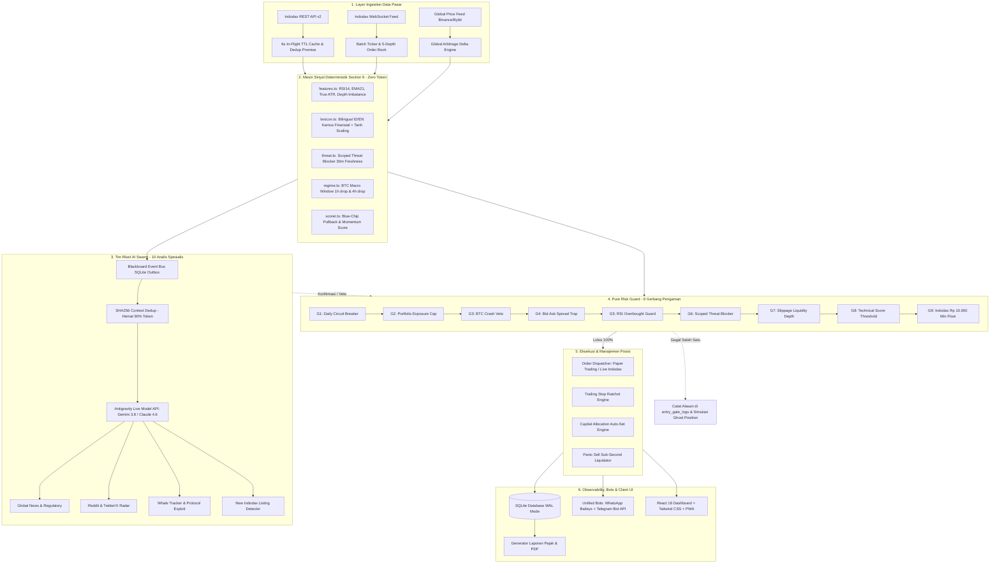
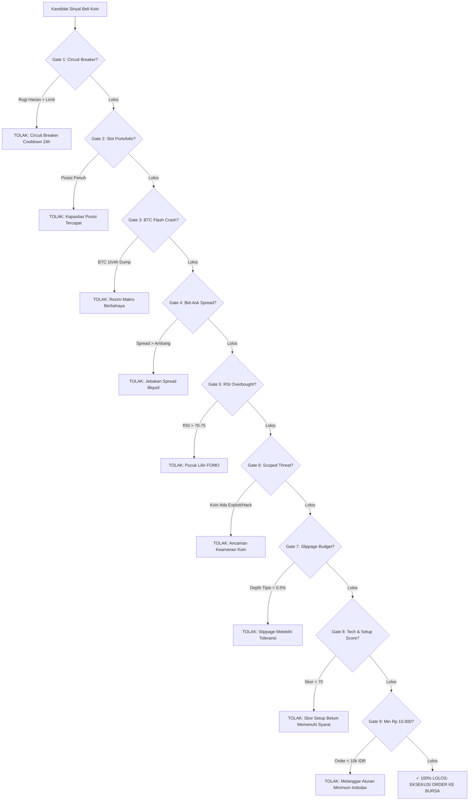

# 🚀 AI Trading Terminal — Autonomous Spot Trading & Multi-Agent Swarm for Indodax


<div align="center">

[-10b981?style=for-the-badge&logo=jest)](tests/)
[](https://www.typescriptlang.org/)
[](https://nodejs.org/)
[](client/)
[](https://indodax.com)
[](client/src/components/BotsView.tsx)
[](src/services/auth/)
[](LICENSE)

**Platform Bot Perdagangan Kripto Otonom Bursa Indodax Terpadu**  
*Menggabungkan Kecepatan Sinyal Deterministik Section 9 (0 Token Cost), Tim Riset AI 10 Sub-Agents, Filter Keamanan 9 Gerbang Risiko Murni, serta Kontrol Remote WhatsApp &amp; Telegram.*

[Fitur Utama](#-fitur-utama) • [Arsitektur Sistem](#-arsitektur-sistem-end-to-end) • [Pipeline 9 Gerbang Risiko](#-pipeline-9-gerbang-risiko-pure-risk-guard) • [Tim Riset AI Swarm](#-tim-riset-ai-multi-agent-10-sub-agents) • [Panduan Memulai](#-panduan-instalasi--menjalankan-1-klik) • [Remote Bots](#-bots-terpadu-whatsapp--telegram) • [Alokasi Modal](#-mesin-alokasi-modal-otomatis-auto-set)

</div>

---

## 📑 Daftar Isi

- [1. Ringkasan & Filosofi Desain](#-ringkasan--filosofi-desain)
- [2. Fitur Utama & Keunggulan](#-fitur-utama--keunggulan)
- [3. Arsitektur Sistem End-to-End](#-arsitektur-sistem-end-to-end)
- [4. Mesin Sinyal Deterministik Section 9](#-mesin-sinyal-deterministik-section-9)
- [5. Pipeline 9 Gerbang Risiko (Pure Risk Guard)](#-pipeline-9-gerbang-risiko-pure-risk-guard)
- [6. Tim Riset AI Multi-Agent (10 Sub-Agents Swarm)](#-tim-riset-ai-multi-agent-10-sub-agents-swarm)
- [7. Validasi Kontrafaktual A/B & Evaluasi Ghost Position](#-validasi-kontrafaktual-ab--evaluasi-ghost-position)
- [8. Mesin Alokasi Modal Otomatis (Auto-Set)](#-mesin-alokasi-modal-otomatis-auto-set)
- [9. Profil Risiko Investasi (Konservatif, Seimbang, Agresif)](#-profil-risiko-investasi)
- [10. Mode Simulasi (Paper) vs Mode Nyata (Live Indodax)](#-mode-simulasi-paper-vs-mode-nyata-live-indodax)
- [11. Bots Terpadu: WhatsApp & Telegram](#-bots-terpadu-whatsapp--telegram)
- [12. Keamanan & Infrastruktur Zero-Trust](#-keamanan--infrastruktur-zero-trust)
- [13. Panduan Instalasi & Menjalankan (1-Klik)](#-panduan-instalasi--menjalankan-1-klik)
- [14. Panduan Menjalankan via Docker](#-panduan-menjalankan-via-docker)
- [15. Struktur Direktori Proyek](#-struktur-direktori-proyek)
- [16. Pengujian & Jaminan Mutu (Test Suite)](#-pengujian--jaminan-mutu-test-suite)
- [17. Tanya Jawab (FAQ) & Solusi Masalah](#-tanya-jawab-faq--solusi-masalah)
- [18. Disclaimer & Pernyataan Risiko](#-disclaimer--pernyataan-risiko)

---

## 💡 Ringkasan & Filosofi Desain

Trading aset kripto secara manual seringkali diwarnai oleh kelelahan emosional, bias psikologis (**FOMO** saat harga di puncak atau **Panic Selling** di titik terendah), serta ketidakmampuan manusia memantau ratusan pasangan koin selama 24 jam nonstop.

**AI Trading Terminal** dibangun dengan satu prinsip fundamental:
> 🛡️ **"Capital Preservation First, Profit Generation Second"**  
> *Lebih baik melewatkan sebuah peluang semu daripada kehilangan modal dalam transaksi yang ceroboh.*

### Mengapa AI Trading Terminal Berbeda?
1. **Tidak Bergantung Sepenuhnya pada AI (Decoupled Architecture):** Model bahasa besar (LLM) sangat hebat untuk membaca berita dan sentimen, namun lambat dan mahal jika dipaksa menganalisa pergerakan harga per detik. Kami memisahkan tugas tersebut:
   - **Section 9 Deterministik:** Menghitung indikator teknikal (RSI, EMA, ATR, Depth) secara matematis dalam waktu **< 2 milidetik** tanpa biaya token (`0 Token Cost`).
   - **Tim Riset AI:** Bekerja di latar belakang menganalisa narasi global, update protokol, dan mendeteksi eksploitasi smart contract dengan deduplikasi hash SHA256 (hemat token > 90%).
2. **9 Lapisan Filter Keselamatan (Pure Risk Guard):** Sinyal beli **wajib lolos 100%** dari seluruh 9 gerbang pengaman sebelum order diizinkan masuk ke bursa Indodax.
3. **Trailing Stop Ratchet Matematis:** Begitu harga koin naik, garis proteksi keuntungan dinaikkan secara bertahap dan **dikunci satu arah**. Jika harga berbalik arah, bot keluar otomatis dengan profit aman.
4. **Siap Digunakan Oleh Siapa Saja (Zero Configuration Launcher):** Dilengkapi launcher 1-klik untuk Windows (`start.bat`), PowerShell (`start.ps1`), dan Linux/macOS (`start.sh`), serta remote control lengkap via WhatsApp dan Telegram.

---

## ✨ Fitur Utama & Keunggulan

| Kategori | Fitur Unggulan | Penjelasan & Manfaat |
| :--- | :--- | :--- |
| **Kecepatan & Biaya** | **Section 9 Engine** | Ekstraksi teknikal murni bebas token, latency sub-millisecond, hemat jutaan token per bulan. |
| **Intelijen Pasar** | **10 AI Sub-Agents** | Swarm analis membaca berita global, Twitter/X, Reddit, Whale on-chain, exploit security, listing baru Indodax. |
| **Proteksi Modal** | **9 Gerbang Risiko** | Circuit breaker harian, anti-spread trap, anti-pucuk RSI, BTC flash crash blocker, exposure capacity. |
| **Presisi Finansial** | **Capital Auto-Set** | Sizing proporsional cerdas berdasarkan saldo IDR (dari modal mikro Rp 10.000 hingga puluhan juta rupiah). |
| **Kunci Keuntungan** | **Trailing Ratchet** | Mengunci keuntungan mengambang secara dinamis; tidak ada istilah *gain* berbalik menjadi rugi besar. |
| **Transparansi UI** | **Entry Diagnostics** | Tabel observabilitas live: alasan koin diterima/ditolak ditampilkan transparan di dashboard. |
| **Remote Control** | **Unified Bots View** | Halaman bot terpadu untuk WhatsApp & Telegram dengan opsi: *Keduanya Sekaligus*, *Hanya WA*, *Hanya TG*, atau *Nonaktif*. |
| **Keamanan** | **Zero-Trust Auth** | Token admin tersandi dengan perbandingan konstan (`timingSafeEqual`) dan rotasi otomatis berkala. |
| **Observabilitas** | **A/B Ghost Positions** | Menguji keputusan tolak AI terhadap pergerakan riil pasar untuk mengukur *AI Alpha* empiris. |
| **Portabilitas** | **PWA & Offline Shell** | UI dapat dipasang sebagai Progressive Web App di smartphone/desktop dengan dark mode modern. |

---

## 🏛️ Arsitektur Sistem End-to-End

Berikut adalah visualisasi arsitektur menyeluruh dari sistem **AI Trading Terminal**:


### Alur Aliran Data Sistem:


---

## ⚡ Mesin Sinyal Deterministik Section 9

Berbeda dengan bot konvensional yang memboroskan API LLM untuk setiap tick harga, AI Trading Terminal menggunakan **Pipeline Deterministik Section 9** di [`src/services/signals/`](src/services/signals/). Pipeline ini berjalan pada memori lokal komputer:

1. **Ekstraksi Fitur Kuantitatif ([`features.ts`](src/services/signals/features.ts)):**
   - **RSI(14) dengan Wilder's Smoothing:** Menghitung momentum harga koin.
   - **Exponential Moving Average (EMA 21):** Mendeteksi tren harga dinamis dan support struktural.
   - **True Average True Range (True ATR):** Mengukur volatilitas sejati dengan memperhitungkan celah lompatan lilin (*gap wicks*).
   - **Depth Imbalance:** Mengukur dominasi dinding order beli (*bid wall*) dibanding dinding jual (*ask wall*) pada 5 kedalaman order book.
   - **Bid-Ask Spread Calculation:** Menghitung persentase celah spread secara presisi.
2. **Kamus Sentimen Finansial Bilingual ([`lexicon.ts`](src/services/signals/lexicon.ts)):**
   - Berisi ratusan leksikon keuangan dalam Bahasa Indonesia dan Bahasa Inggris (seperti *lonjakan, adopsi, kemitraan, peretasan, gugatan, delisting*).
   - Menggunakan fungsi aktivasi **Hyperbolic Tangent (`tanh`)** untuk memastikan nilai sentimen selalu berada di rentang ketat `[-1.0, +1.0]`.
   - Menerapkan **Age Decay 48 Jam**: Berita baru berbobot penuh, berita lama meluruh secara matematis.
3. **Scoped Threat Blocker ([`threat.ts`](src/services/signals/threat.ts)):**
   - Mengisolasi ancaman per koin (*coin-scoped*). Ancaman eksploitasi pada koin meme tidak akan memblokir koin papan atas seperti Bitcoin atau Ethereum.
   - Mengabaikan kata umum tidak bersalah seperti `"sec"` (detik) atau `"second"`.
   - Memiliki masa kedaluwarsa kesegaran (**Freshness: 30 menit**), sehingga pasar tidak beku selamanya.
4. **Rezim Makro BTC Window Returns ([`regime.ts`](src/services/signals/regime.ts)):**
   - Menghitung return pergerakan harga Bitcoin pada jendela waktu **1 jam (`<= -3%`)** dan **4 jam (`<= -5%`)**.
   - Mampu mendeteksi kejatuhan mendadak (*flash crash*) tanpa mematikan bot saat pasar hanya konsolidasi normal 1-2% di bawah harga tertinggi 24 jam.
5. **Skor Peluang & Pullback Blue-Chip ([`scorer.ts`](src/services/signals/scorer.ts)):**
   - Memungkinkan profil Konservatif tetap aktif membeli koin berkapitalisasi besar (BTC, ETH, SOL) saat terjadi *pullback* sehat ke garis support EMA21 dengan RSI di area sejuk (< 48).

---

## 🛡️ Pipeline 9 Gerbang Risiko (Pure Risk Guard)

Setiap kandidat sinyal beli wajib melewati rangkaian **9 Gerbang Pertahanan** di [`src/services/trading/riskGuard.ts`](src/services/trading/riskGuard.ts):




### Rincian Pemeriksaan Ke-9 Gerbang:
1. **Gate 1 — Circuit Breaker:** Menghitung total kerugian terealisasi hari ini. Jika melebihi batas profil risiko (misal 5%), auto-trading dihentikan selama 24 jam untuk melindungi sisa modal. Menggunakan *decoupled ratchet* agar tidak terjadi kebuntuan (*deadlock*).
2. **Gate 2 — Exposure Limit:** Memastikan jumlah posisi terbuka tidak melebihi kuota profil (misal maksimal 2-5 koin).
3. **Gate 3 — BTC Macro Regime:** Membatalkan entri semua koin jika Bitcoin mengalami *flash dump* (turun > 3% dalam 1 jam atau > 5% dalam 4 jam).
4. **Gate 4 — Spread Trap:** Menolak koin yang selisih harga jual dan beli (*bid-ask spread*) terlalu lebar (> 0.8% - 1.5%), melindungi Anda dari jebakan koin tidak likuid.
5. **Gate 5 — RSI Guard (Anti-Pucuk):** Mencegah bot membeli koin yang RSI-nya sudah berada di atas 70 atau 75 (zona jenuh beli ekstrim).
6. **Gate 6 — Scoped Threat:** Memverifikasi koin tidak sedang terlibat insiden keamanan, eksploitasi smart contract, atau ancaman delisting dalam 30 menit terakhir.
7. **Gate 7 — Slippage Budget:** Mensimulasikan eksekusi order terhadap 5 tingkat kedalaman buku order Indodax untuk menjamin harga beli tidak bergeser lebih dari 0.5%.
8. **Gate 8 — Technical Score:** Mengharuskan skor teknikal gabungan mencapai ambang batas minimal (default 70/100).
9. **Gate 9 — Indodax Minimum Floor:** Memastikan nilai order setelah dikurangi cadangan tunai bernilai **minimal Rp 10.000**, sesuai regulasi bursa Indodax.

---

## 🤖 Tim Riset AI Multi-Agent (10 Sub-Agents Swarm)

Di tab **Riset AI**, terdapat 10 analis intelijen spesialis di [`src/services/agents/`](src/services/agents/) yang berkoordinasi melalui arsitektur **Blackboard Bus**:


1. **Global News Analyst:** Membaca feed berita internasional (CoinDesk, CoinTelegraph, Bloomberg, Decrypt).
2. **Tech & Ecosystem Analyst:** Menganalisa rilis GitHub, hard fork, dan update mainnet pengembang koin.
3. **Social Community Radar:** Memantau tren dan sentimen diskusi di forum Reddit kripto.
4. **Twitter / X Viral Radar:** Mendeteksi pembicaraan viral dari figur berpengaruh di dunia kripto.
5. **Indodax Listing Radar:** Mendeteksi koin baru yang resmi listing di Indodax dalam hitungan detik.
6. **Momentum & Breakout Hunter:** Menangkap koin yang mengalami lonjakan volume dan likuiditas mendadak.
7. **Protocol Security & Exploit Radar:** Memindai insiden keamanan smart contract dan laporan exploit.
8. **Macro & Regulatory Radar:** Memantau pengumuman suku bunga The Fed, inflasi CPI, dan regulasi Bappebti.
9. **Whale On-Chain Tracker:** Mendeteksi perpindahan koin skala raksasa oleh para *whale* ke bursa.
10. **Global Arbitrage Analyst:** Membandingkan selisih harga koin di Indodax terhadap bursa global (Binance, Bybit).

### Optimalisasi Hemat Token & Mode Degraded
- **Fingerprint SHA256:** Sistem menghitung hash judul berita dan kondisi harga. Jika kondisi tidak berubah, analisis AI **dilewati otomatis** (`skipped_dedup`), menghemat **> 90% biaya token**.
- **Kompaksi Payload:** Prompt dikirim dalam format JSON ringkas 1-baris tanpa spasi kosong boros.
- **Degraded Mode Fail-Safe:** Jika penyedia AI mengalami gangguan jaringan atau kehabisan kuota, sistem otomatis beralih ke mode deterministik murni, sehingga bot tidak pernah macet.

---

## 🔬 Validasi Kontrafaktual A/B & Evaluasi Ghost Position

Bagaimana Anda membuktikan bahwa filter AI benar-benar melindungi modal Anda dan bukan sekadar membuang peluang menguntungkan?

AI Trading Terminal menyertakan mesin **A/B Counterfactual Testing**:
- Setiap kali tim riset AI atau gerbang risiko menolak suatu peluang beli, sistem membuat sebuah **Ghost Position** (posisi virtual bayangan) di database [`ghost_positions`](src/db/index.ts).
- Posisi bayangan ini dipantau secara real-time mengikuti harga pasar riil Indodax seolah-olah transaksi tersebut dieksekusi.
- Setelah beberapa waktu, sistem mengelompokkan hasilnya:
  - 🛡️ **`BULLET_DODGED` (Peluru Dihindari):** Transaksi yang ditolak AI ternyata mengalami kerugian/stop out di pasar riil. Ini membuktikan AI berhasil menyelamatkan modal Anda!
  - ⚠️ **`MISSED_OPPORTUNITY` (Peluang Terlewat):** Transaksi yang ditolak ternyata menghasilkan keuntungan.
  - ⚖️ **`NEUTRAL`:** Transaksi ditolak berakhir impas.
- Dashboard menampilkan metrik **Empirical AI Alpha**: nilai nyata persentase modal yang berhasil diselamatkan oleh kecerdasan buatan.

---

## 💰 Mesin Alokasi Modal Otomatis (Auto-Set)

Fitur **Capital Allocation Auto-Set** di [`src/services/trading/index.ts`](src/services/trading/index.ts) menghilangkan kerumitan menghitung ukuran lot trading:


### Matriks Alokasi Berdasarkan Besaran Modal:

| Besaran Modal IDR | Kategori Tier | Maksimal Posisi Terbuka | Alokasi per Posisi | Cadangan Tunai | Catatan & Perilaku |
| :--- | :--- | :---: | :---: | :---: | :--- |
| **< Rp 100.000** | **Mikro** | **1 Koin** | Seluruh modal teralokasi | 15% | Menjamin order selalu di atas batas bursa **Rp 10.000**. |
| **Rp 100k - 1 Juta** | **Kecil** | **2 - 3 Koin** | 28% - 42.5% | 15% | Diversifikasi sehat antara koin stabil dan momentum. |
| **Rp 1 Juta - 10 Juta** | **Menengah** | **3 - 5 Koin** | 17% - 28% | 15% - 20% | Diversifikasi penuh dengan pemantauan slippage mendalam. |
| **> Rp 10.000.000** | **Besar** | **5 Koin** | Sesuai batas risiko | 20% - 25% | Mengutamakan likuiditas tebal dan koin Blue-Chip. |

> 💡 **Kontrol Instan:** Anda dapat mengubah modal kapan saja melalui dashboard UI atau mengirim pesan singkat ke bot WhatsApp/Telegram: `/modal 500000 seimbang`.

---

## 🎯 Profil Risiko Investasi

Sesuaikan strategi bot hanya dengan satu kali klik di tab **Pengaturan &rarr; Profil Risiko**:


| Parameter Strategi | 🛡️ Konservatif | ⚖️ Seimbang *(Rekomendasi)* | 🚀 Agresif |
| :--- | :--- | :--- | :--- |
| **Target Keuntungan (TP)** | 3.5% | 5.0% | 7.5% |
| **Trailing Stop Ratchet** | 1.8% (Ketat) | 2.5% (Moderat) | 3.5% (Longgar) |
| **Kapasitas Posisi Simultan** | Maksimal 2 Koin | Maksimal 3 Koin | Maksimal 5 Koin |
| **Fokus Keranjang Koin** | Koin Tier 1 (BTC, ETH, SOL) | Top 20 Likuiditas Indodax | Koin Momentum & New Listing |
| **Circuit Breaker Harian** | 3.0% Kerugian Maksimal | 5.0% Kerugian Maksimal | 7.0% Kerugian Maksimal |
| **Karakter Pengguna** | Pemula & pemilik modal besar | Sebagian besar trader normal | Trader berpengalaman di Bull Run |

---

## 🔄 Mode Simulasi (Paper) vs Mode Nyata (Live Indodax)

### 1. Mode Demo (Paper Trading) — Tanpa Risiko Uang Riil
- Dilengkapi saldo virtual **Rp 10.000.000**.
- Membaca pergerakan harga asli bursa Indodax secara real-time.
- Mensimulasikan order beli, biaya fee transaksi bursa (0.51%), slippage buku order, dan eksekusi trailing stop persis seperti akun riil.
- Sangat disarankan untuk menguji strategi selama 3-7 hari sebelum menggunakan dana nyata.

### 2. Mode Live (Uang Nyata Indodax) — Eksekusi Transaksi Riil
- Terhubung langsung dengan akun Indodax Anda via API Key & Secret Key.
- Dilengkapi modal persetujuan keselamatan **3-Poin Interaktif** sebelum aktivasi.
- Seluruh order ditempatkan langsung ke buku order Indodax.
- Tombol **Panic Sell (< 1 Detik)** siap melikuidasi seluruh posisi ke IDR dan membatalkan semua antrean order jika terjadi kondisi darurat global.

---

## 📱 Bots Terpadu: WhatsApp & Telegram

Seluruh kendali dan pengaturan bot notifikasi kini disatukan dalam **satu halaman terpusat** di tab **Bots**:


### Opsi Saluran Notifikasi (Notification Selector):
1. 🚀 **Keduanya Sekaligus (WhatsApp + Telegram):** Mengirim alert beli/jual, laporan profit, dan peringatan darurat ke kedua aplikasi secara simultan *(Rekomendasi)*.
2. 🟢 **Hanya WhatsApp:** Menggunakan koneksi WhatsApp Web Baileys.
3. 🔵 **Hanya Telegram:** Menggunakan bot Telegram resmi (mudah, cukup masukkan Token & Chat ID).
4. 🛑 **Nonaktifkan Semua Bot:** Mode hening total tanpa siaran pesan.

### Daftar Perintah Remote (Kirim ke Chat Bot):
| Perintah | Hak Akses | Deskripsi Fungsi |
| :--- | :---: | :--- |
| `/status` | Publik / Admin | Melihat status mesin, bursa, dan posisi terbuka saat ini. |
| `/profit` | Publik / Admin | Ringkasan laba bersih dan performa trading hari ini. |
| `/koin` | Publik / Admin | Daftar 5 koin dengan kenaikan tertinggi hari ini di Indodax. |
| `/modal <nominal> [profil]` | **Khusus Admin** | Mengatur alokasi modal dan profil risiko otomatis dari HP. |
| `/start` | **Khusus Admin** | Mengaktifkan mesin auto-trading dari jarak jauh. |
| `/stop` | **Khusus Admin** | Menghentikan/menjeda auto-trading. |
| `/panic` | **Khusus Admin** | Menjual seluruh posisi terbuka ke IDR seketika (< 1 detik). |
| `/balance` | **Khusus Admin** | Memeriksa saldo IDR dan total estimasi aset Indodax. |
| `/admin <token>` | Verifikasi | Mendaftarkan nomor HP pengirim sebagai Administrator baru via token. |
| `/help` | Publik / Admin | Menampilkan panduan bantuan perintah. |

---

## 🔒 Keamanan & Infrastruktur Zero-Trust

Keamanan modal dan integritas sistem adalah prioritas nomor satu:

1. **Aturan API Key Indodax:**
   - Bot **HANYA** memerlukan izin `View (Read)` dan `Trading (Trade)`.
   - ❌ **JANGAN PERNAH MENGAKTIFKAN IZIN WITHDRAW/PENARIKAN!** Tanpa izin withdraw, saldo Anda 100% aman di bursa Indodax.
2. **Zero-Trust Admin Access Token:**
   - Otentikasi dashboard dan endpoint administratif dilindungi token hex 32-karakter.
   - Pengecekan token menggunakan `crypto.timingSafeEqual` untuk mencegah serangan analisis waktu (*timing attack*).
   - Pengunjung tanpa token hanya dapat melihat dashboard dalam mode pantau (*View-Only*).
3. **Layanan Rotasi Token Otomatis ([`tokenRotationService.ts`](src/services/auth/tokenRotationService.ts)):**
   - Mendukung mode rotasi: *Tetap (Fixed)*, *Saat Startup*, atau *Interval Berkala (1 jam, 24 jam, dll.)*.
4. **Database SQLite Terisolasi & Auto-Backup ([`backupService.ts`](src/services/backup/backupService.ts)):**
   - Database berjalan dalam mode **WAL (Write-Ahead Logging)** yang cepat dan tahan korupsi data saat listrik padam mendadak.
   - Snapshot backup terverifikasi dibuat otomatis di folder `backups/` dan dapat diunduh langsung dari UI Laporan.
5. **Ekspor Laporan Pajak & Transaksi:**
   - Mendukung ekspor data transaksi ke file spreadsheet **CSV (Excel)** dan dokumen **PDF Resmi** dengan format rapi untuk keperluan audit dan pelaporan pajak.

---

## 🚀 Panduan Instalasi & Menjalankan (1-Klik)

### Persyaratan Minimum:
- **Node.js:** Versi **18.0.0** atau lebih baru ([Download Node.js](https://nodejs.org/)).
- **Sistem Operasi:** Windows 10/11, macOS, atau Linux (Ubuntu/Debian).
- **Koneksi Internet:** Stabil untuk streaming data pasar bursa Indodax.

### Cara Menjalankan Menggunakan Launcher 1-Klik:

#### 🪟 Pengguna Windows:
1. Ekstrak folder aplikasi di komputer Anda.
2. Klik ganda (**double-click**) file **`start.bat`** (atau klik kanan `start.ps1` lalu pilih *Run with PowerShell*).
3. Launcher akan otomatis memeriksa dependency, mengompilasi aplikasi, dan membuka browser Anda ke:
   ```
   http://localhost:3001
   ```

#### 🐧 Pengguna Linux / macOS:
1. Buka terminal di folder aplikasi.
2. Berikan izin eksekusi lalu jalankan script:
   ```bash
   chmod +x start.sh
   ./start.sh
   ```
3. Buka browser Anda ke `http://localhost:3001`.

---

## 🐳 Panduan Menjalankan via Docker

Untuk menjalankan bot di server VPS tanpa perlu instalasi Node.js lokal:

```bash
# 1. Salin template environment
cp .env.example .env

# 2. Bangun dan jalankan container di latar belakang
docker compose up -d --build

# 3. Periksa status log dan Admin Token
docker compose logs -f
```
Akses dashboard di browser melalui `http://IP-SERVER-ANDA:3001`.

---

## 📂 Struktur Direktori Proyek


| Direktori / Modul | Jalur (Path) | Peran & Tanggung Jawab Utama |
| :--- | :--- | :--- |
| **Frontend Web (PWA)** | `client/` | Antarmuka React 18, Tailwind CSS, Vite, Lucide Icons, service worker, & icons PWA. |
| **Komponen UI** | `client/src/components/` | `DashboardView`, `BotsView`, `EntryDiagnosticsSection`, `QuotaView`, `ReportView`. |
| **Dokumentasi & Visual** | `docs/` | `docs/assets/` (SVG resolusi tinggi), `PANDUAN_PENGGUNA.md`, & laporan implementasi. |
| **Quantitative Signals** | `src/services/signals/` | Pipeline deterministik Section 9 (`features`, `lexicon`, `threat`, `regime`, `scorer`). |
| **Trading & Risk Guard** | `src/services/trading/` | 9 Gerbang risiko (`riskGuard`), trailing ratchet, & mesin alokasi modal (`auto-set`). |
| **Tim Riset AI Swarm** | `src/services/agents/` | 10 Agen intelijen spesialis, Blackboard bus outbox SQLite, & deduplikasi SHA-256. |
| **Klien Bursa Indodax** | `src/services/indodax/` | Wrapper REST v2 & WebSocket dengan 6s in-flight cache & promise deduplication. |
| **Bots Remote Control** | `src/services/whatsapp/` & `telegram/` | Engine WhatsApp Baileys Multi-Device & integrasi Telegram Official Bot API. |
| **Keamanan & Otorisasi** | `src/services/auth/` | Layanan rotasi token admin & verifikasi otentikasi konstan `crypto.timingSafeEqual`. |
| **Database & Backup** | `src/db/` & `src/services/backup/` | SQLite WAL engine, migrasi skema tabel, serta auto-snapshot backup terverifikasi. |
| **REST API Server** | `src/api/` & `src/server.ts` | Endpoint Express, webhook bursa, proteksi middleware admin, & server lifecycle. |
| **Rangkaian Pengujian** | `tests/` | 95 unit & integration tests covering 100% path kritis logika kuantitatif & keamanan. |
| **Launcher 1-Klik** | `start.bat`, `start.ps1`, `start.sh` | Launcher otomatis sekali klik untuk Windows (CMD/PowerShell) dan Linux/macOS. |
| **Deployment Docker** | `Dockerfile`, `docker-compose.yml` | Konfigurasi kontainerisasi multi-stage build untuk hosting di VPS server 24/7. |

> [!NOTE]
> **Arsitektur Full-Stack Terpadu (Backend & Frontend Client):**
> Proyek ini menggunakan struktur modular standar industri:
> - **`src/` (Backend Engine):** Otak sistem — memproses sinyal deterministik Section 9, mengeksekusi 9 gerbang risiko, mengoordinasikan tim riset AI, mengelola database SQLite, dan menghubungkan bot WhatsApp/Telegram.
> - **`client/` (Frontend Dashboard):** Antarmuka visual yang Anda lihat di browser (`http://localhost:3001`) — menyajikan grafik candlestick, kontrol trading, scanner pasar, panel telemetri kuota, dan tabel diagnostik 9 gerbang.
> - Keduanya terkompilasi dan berjalan bersamaan dalam 1 server terpadu melalui perintah launcher bawaan (`start.bat` / `start.sh`).

---

## 🧪 Pengujian & Jaminan Mutu (Test Suite)

Seluruh logika bisnis, keamanan token, perhitungan kuantitatif, dan pipeline gerbang risiko dilindungi oleh **95 unit & integration tests** di [`tests/`](tests/):

```bash
# Menjalankan seluruh test suite otomatis:
npm test
```

### Ringkasan Hasil Pengujian Terakhir:
```
✔ Capital Allocation & Auto-Set Engine (5 tests passing)
✔ Quantitative Indicators (RSI, EMA, True ATR) & Spread Mechanics (5 tests passing)
✔ Performance Reporting Engine & CSV Export (2 tests passing)
✔ Database Backup Service (1 test passing)
✔ Telegram Notifier Service (2 tests passing)
✔ Section 9 Lexicon Sentiment Scoring & Age Decay (4 tests passing)
✔ P0-A Fix: Scoped Threat Blocker & False Alarm Elimination (4 tests passing)
✔ BTC Macro Regime Window Returns (1h & 4h) (3 tests passing)
✔ Conservative Blue-Chip Pullback Opportunity Scoring (2 tests passing)
✔ Pure Risk Guard Execution Pipeline (Gates 1-8) (6 tests passing)
✔ Multi-Agent Blackboard Bus & Outbox Persistence (1 test passing)
✔ Asset-Agnostic MarketAdapter Abstraction (1 test passing)
✔ A/B Counterfactual Logging & Ghost Position Lifecycle (3 tests passing)
✔ Antigravity Live Model Discovery, Multi-Account, & Quota Telemetry (7 tests passing)
✔ WhatsApp Multi-Device LID Authorization & /admin Pairing (4 tests passing)
✔ Admin Access Token Rotation Service & Zero-Trust Comparison (8 tests passing)
✔ Circuit Breaker Resilience & Decoupled Ratchet (1 test passing)
...
---------------------------------------------------------------------------------
ℹ tests 95 | suites 29 | pass 95 | fail 0 | cancelled 0 | duration ~2s - 96s (sub-second local / cached)
---------------------------------------------------------------------------------
```

Kompilasi produksi frontend dan backend:
```bash
npm run build
# Menjalankan tsc strict check & build client Vite (lolos 100% tanpa error)
```

---

## ❓ Tanya Jawab (FAQ) & Solusi Masalah

#### Q1: Mengapa bot belum melakukan pembelian koin sama sekali hari ini?
> **A:** Ini adalah bukti bahwa **9 Gerbang Risiko** bekerja optimal! Bot tidak bertransaksi membabi buta. Jika spread sedang lebar, Bitcoin sedang drop, atau RSI koin sedang di pucuk, bot akan menahan diri demi menyelamatkan modal Anda. Anda dapat melihat alasan penolakan secara transparan di tabel **Diagnostik 9 Gerbang Masuk** pada dashboard.

#### Q2: Apakah saya harus membiarkan komputer menyala 24 jam?
> **A:** Ya, bot memantau trailing stop setiap detik. Jika komputer mati, bot tidak dapat mengeksekusi order secara real-time. Jika Anda ingin bot berjalan tanpa komputer rumah menyala, Anda dapat memasang bot di VPS Linux menggunakan Docker atau script `start.sh`.

#### Q3: Apakah aman memasukkan API Key Indodax ke dalam bot ini?
> **A:** Sangat aman! API Key disimpan di database SQLite lokal di komputer Anda sendiri (bukan di server luar/pihak ketiga). Selain itu, Anda **hanya mengaktifkan izin Read dan Trade**—jangan pernah centang izin Withdraw. Tanpa izin penarikan, dana rupiah maupun kripto Anda tidak dapat dipindahkan keluar dari akun Indodax Anda.

#### Q4: Di mana saya bisa menemukan Admin Access Token jika jendela terminal terlanjur ditutup?
> **A:** Anda dapat me-restart aplikasi dengan menjalankan launcher `start.bat` / `./start.sh`. Token aktif akan dicetak ulang di jendela terminal.

#### Q5: Bagaimana cara mengganti nomor WhatsApp atau Telegram yang menerima notifikasi?
> **A:** Buka tab **Bots** di dashboard. Untuk WhatsApp, klik tombol *Logout* lalu scan ulang QR Code dengan nomor baru. Untuk Telegram, cukup ganti Chat ID target dan simpan pengaturan.

---

## ⚠️ Disclaimer & Pernyataan Risiko

1. **Risiko Finansial:** Perdagangan aset kripto memiliki tingkat volatilitas harga yang tinggi. Meskipun sistem ini dilengkapi dengan 9 gerbang pengaman risiko dan trailing stop dinamis, tidak ada sistem perdagangan otomatis yang dapat menjamin profit 100% di segala kondisi pasar ekstrem.
2. **Uji Coba Wajib:** Pengguna sangat disarankan untuk menjalankan bot dalam **Mode Demo (Paper Trading)** minimal selama 3 hingga 7 hari sebelum beralih ke Mode Nyata.
3. **Modal Dingin:** Gunakan hanya modal dingin (*uang yang siap Anda alokasikan untuk investasi berisiko*) dan jangan pernah memperdagangkan uang kebutuhan mendesak.
4. **Tanggung Jawab Pengguna:** Pengembang perangkat lunak ini tidak bertanggung jawab atas keputusan investasi finansial pribadi, kerugian akibat kegagalan koneksi internet pengguna, atau kelalaian dalam menjaga kerahasiaan API Key bursa Anda.

---

<div align="center">

**AI TRADING TERMINAL — DIBANGUN DENGAN TEKNOLOGI KUANTITATIF &amp; KEAMANAN TINGKAT TINGGI**  
*Melindungi Modal Anda, Menangkap Peluang Tanpa Emosi.*

⭐ **Beri Bintang di GitHub jika aplikasi ini bermanfaat untuk perjalanan trading Anda!** ⭐

</div>
