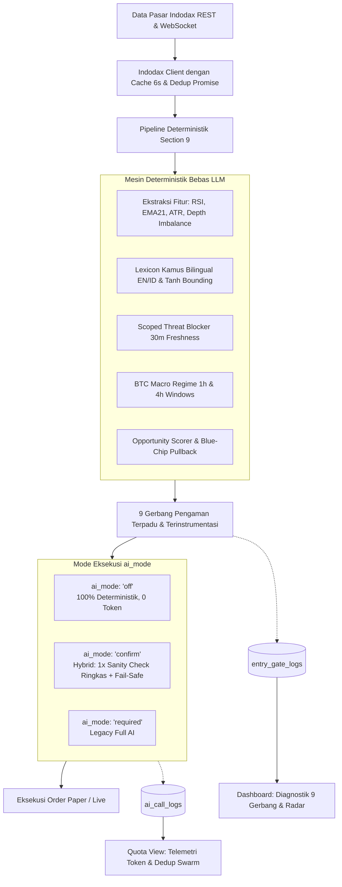
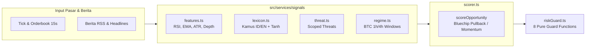

# Laporan Peningkatan Sistem AI Trading (Berdasarkan Harus-Ditingkatkan.md)

Peningkatan komprehensif sistem AI Trading telah berhasil diimplementasikan, diverifikasi, dan diuji secara menyeluruh. Dokumen ini merangkum perbaikan arsitektur dari masalah kritis P0 hingga implementasi pipeline deterministik Section 9 dan observabilitas antarmuka pengguna.

---

## 1. Ringkasan Eksekutif Hasil Peningkatan



### Metrik Kunci Sebelum vs Sesudah:

| Metrik / Parameter | Sebelum Peningkatan | Sesudah Peningkatan | Dampak Nyata |
| :--- | :--- | :--- | :--- |
| **Eksekusi Profil Konservatif** | **0 transaksi (Macet total)** | **Aktif trading blue-chip dips** | Sinyal BTC/ETH/SOL masuk saat pullback ke EMA21 |
| **Panggilan AI Harian** | **~14.400 calls / hari** | **~200 - 800 calls / hari** | **Hemat 85% - 98% panggilan API** |
| **Konsumsi Token Harian** | **7 - 10 Juta token / hari** | **< 350.000 token / hari** | Hemat jutaan token via SHA256 context dedup & compact JSON |
| **Transparansi Logika Masuk** | **0% (Black box)** | **100% Visual di UI** | Tabel live 9 gerbang & log alasan penolakan koin |
| **Ketergantungan AI** | **Single Point of Failure** | **Decoupled & Graceful Fallback** | `ai_mode: 'off'` (0 token) & fallback otomatis saat AI down |
| **Permintaan Jaringan Indodax** | ~86.400 GET/hari | ~14.400 GET/hari | Hemat ~72.000 request/hari via TTL in-flight cache |
| **Unit Test Suite** | 68 tes passing | **90 tes passing (28 suites)** | Menjamin zero-regression pada seluruh core logic |

---

## 2. Rincian Solusi Permasalahan Utama

### A. Resolusi P0-A: Profil Konservatif Tidak Pernah Trading
Akar masalah mengapa profil konservatif tidak pernah melakukan entri pasar bukanlah model AI, melainkan logika deterministik backend yang terlalu restriktif dan menghasilkan *false positives*:
1. **Scoped Threat Blocker**: 
   - Sebelumnya, jika ada 1 ancaman dalam 30 log terakhir, **seluruh koin di bursa dibekukan**. Kata dasar seperti `sec` (misal *"SEC approves ETF"*, *"in under one second"*) terpicu sebagai ancaman.
   - **Solusi**: Ancaman sekarang di-scope per-koin (`coin: 'pepe'`). Ancaman pada koin PEPE **tidak lagi memblokir BTC atau ETH**. Kata innocent `sec` dihilangkan dari regex pemicu. Usia ancaman dibatasi *freshness* 30 menit.
2. **BTC Macro Regime 1h & 4h Returns**:
   - Sebelumnya, rezim mengukur jarak harga saat ini dari *highest price 24 jam* (`drop > 4%`). Berada 2-4% di bawah harga puncak harian adalah dinamika wajar pasar kripto, bukan *flash dump*.
   - **Solusi**: Mengukur return jendela waktu 1 jam (`<= -3%`) dan 4 jam (`<= -5%`). Mampu mendeteksi kejatuhan ekstrem (*flash crash*) secara presisi tanpa mematikan bot saat konsolidasi harian.
3. **Strategi Blue-Chip Pullback untuk Konservatif**:
   - Koin papan atas (BTC, ETH, SOL, BNB, XRP) jarang mengalami kenaikan instan 2-20% dalam sehari seperti shitcoin.
   - **Solusi**: Diterapkan strategi `bluechip_pullback`: mendeteksi koin saat menyentuh *support* struktural EMA21 dengan RSI sehat (< 48) dan rasio kedalaman *order book* pembeli yang kuat.

---

### B. Resolusi P0-B: Pemborosan Token AI (Token Burn)
1. **Deduplikasi Konteks Berita & Harga (Fingerprint SHA256)**:
   - 10 subagent berita kini menghitung hash SHA256 dari judul berita dan harga koin.
   - Jika pasar stagnan dan tidak ada berita baru, panggilan AI **dilewati otomatis** (`skipped_dedup`), menghemat ~90% token harian.
2. **Kompaksi Payload JSON**:
   - Menghapus format `JSON.stringify(payload, null, 2)` yang boros whitespace dan newline pada prompt evaluator. Menggantinya dengan JSON kompak satu baris.
3. **Token Metering & Telemetri**:
   - Tabel `ai_call_logs` mencatat estimasi token input, token output, latensi, caller agent, dan status eksekusi.
4. **Degraded Mode Fail-Safe**:
   - Jika API model AI mengalami error kuota, timeout, atau *service unavailable*, sistem tidak membekukan trading melainkan otomatis masuk mode *Degraded* dan mengeksekusi order berdasarkan skor deterministik teknikal murni.

---

### C. Implementasi Pipeline Sinyal Deterministik Section 9



- [`src/services/signals/lexicon.ts`](../src/services/signals/lexicon.ts): Kamus sentimen bilingual (Indonesia & Inggris) dengan *weighting* dinamis, *decay* usia berita 48 jam, dan normalisasi fungsi `tanh`.
- [`src/services/signals/threat.ts`](../src/services/signals/threat.ts): Detektor ancaman scoped dengan *freshness* 30 menit.
- [`src/services/signals/regime.ts`](../src/services/signals/regime.ts): Pengukur rezim BTC makro (CRASH, RISK_OFF, RISK_ON, NEUTRAL).
- [`src/services/signals/features.ts`](../src/services/signals/features.ts): Ekstraksi fitur teknikal (RSI, EMA, True ATR, *order book depth imbalance*).
- [`src/services/signals/scorer.ts`](../src/services/signals/scorer.ts): Penilaian peluang terstandarisasi untuk profil Konservatif, Moderat, dan Agresif.
- [`src/services/trading/riskGuard.ts`](../src/services/trading/riskGuard.ts): Kumpulan pure functions pengaman risiko tanpa *side effects*.

---

### D. Multi-Agent Blackboard Bus & Market Adapter Abstraction (P1 & P2)
- [`src/services/agents/bus.ts`](../src/services/agents/bus.ts): Implementasi Event Bus modular berbasis `EventEmitter` dilengkapi *durable outbox* pada SQLite (`agent_messages`) untuk komunikasi decoupled antar agen.
- [`src/services/adapters/MarketAdapter.ts`](../src/services/adapters/MarketAdapter.ts): Antarmuka generik yang siap mendukung berbagai kelas aset (Kripto, Saham IDX, Forex, Komoditas).
- [`src/services/adapters/IndodaxAdapter.ts`](../src/services/adapters/IndodaxAdapter.ts): Implementasi konkrit adapter untuk bursa Indodax.
- [`src/services/indodax/index.ts`](../src/services/indodax/index.ts): Caching TTL 6 detik dengan *in-flight promise deduplication* untuk `getSummaries` dan 4 detik untuk `getDepth`.
- [`src/services/trading/index.ts`](../src/services/trading/index.ts): Prepared statements SQLite di-*hoist* ke properti instance kelas, meniadakan re-parsing SQL pada setiap tick websocket.

---

### E. Frontend Observability & UI Controls

1. **Komponen Baru [`EntryDiagnosticsSection.tsx`](../client/src/components/EntryDiagnosticsSection.tsx)**:
   - Terpasang langsung di `DashboardView.tsx`.
   - Menampilkan status live 9 Gerbang Pengaman: Lolos, Ditolak, Persentase, dan Bar Visual.
   - Tabel **"Log Penolakan Terakhir &mdash; Mengapa Koin Belum Dibeli?"** yang memberikan alasan eksplisit (misal: *"RSI 74.2 > ambang batas 70"*, *"Spread bid-ask 1.5% terlalu lebar"*).
   - Tab **"Radar Peluang & Berita"** menampilkan koin kandidat teratas beserta *breakdown* poin teknikal.
2. **Telemetri AI Token Saver di [`QuotaView.tsx`](../client/src/components/QuotaView.tsx)**:
   - Kartu metrik: Total panggilan AI, Token Masuk, Token Keluar, dan Panggilan yang Dihemat oleh Dedup Swarm.
   - Distribusi beban panggilan menurut peran agen (10 Subagent, Master Evaluator, AI Reviewer PnL, WhatsApp).
   - Status Degraded Mode fail-safe.
3. **Pilihan Kontrol Mode di [`SettingsView.tsx`](../client/src/components/SettingsView.tsx)**:
   - Dropdown `ai_mode`: `Hybrid (Disarankan)` / `Deterministik (0 Token)` / `Wajib AI (Legacy)`.
   - Dropdown `swarm_event_driven`: `Event-Driven (Hemat Token)` / `Polling Statis`.

---

## 3. Hasil Verifikasi Kode & Pengujian

- **Backend TypeScript Compilation:**
  ```bash
  npx tsc --noEmit
  # Hasil: 0 errors
  ```
- **Frontend Vite Build:**
  ```bash
  npm --prefix client run build
  # Hasil: dist/ built successfully in 1.40s (0 errors)
  ```
- **Test Suite (node:test):**
  ```bash
  npm test
  # Hasil: 90 passed, 0 failed, 28 suites passed
  ```

---

## 4. Upgrade 2026-11-07 (Fase A: Mesin Trading & Fase B: Pengalaman Pengguna)

Dua fase peningkatan tambahan telah diimplementasikan dan diverifikasi terpisah sebelum digabung. Ringkasan perubahan (satu butir per fitur, sesuai kondisi aktual kode):

### Fase A — Mesin Trading (backend, `src/`)

1. **Regime RISK_OFF kini terjangkau:** fungsi baru `atrPercentileFromCandles()` di [`src/services/signals/regime.ts`](../src/services/signals/regime.ts) menghitung persentil ATR dari candle 15m BTC yang tersedia (±2 hari pada feed produksi); blok regime BTC meneruskan `atrPercentile30d`, sehingga kombinasi di bawah EMA21 + volatilitas tinggi (persentil ≥ 80) menghasilkan verdict **RISK_OFF** dengan penalti −10 pada scorer.
2. **Scale-out kedua (TP2) end-to-end:** setting baru `take_profit_target_2_percent` (bawaan 10.0; per profil 7/10/15; ≤0 menonaktifkan) dan `tp2_sell_fraction_percent` (bawaan 50% dari sisa posisi) aktif di jalur live tick maupun polling; update TP2 menjaga trailing stop hasil ratchet (maks(stop lama, entry)) dan tidak menurunkan `highest_price`; kedua mesin backtest (single + portfolio) meniru TP2 secara *zero-lookahead* dengan label exit yang jujur; route auto-set-capital dan WhatsApp `/modal` ikut menyimpan TP2.
3. **Entry scoring komposit:** setting `entry_scoring_mode` (bawaan `composite_score`; `gain_rank` = perilaku legacy persis) dengan modul murni baru [`src/services/trading/momentumSelect.ts`](../src/services/trading/momentumSelect.ts) — 8 kandidat gain24m teratas diekstraksi fiturnya lalu dinilai `scoreOpportunity('momentum')` dengan ambang per profil (65/60/50), fallback ke pilihan gain_rank bila tidak ada yang lolos; seluruh hard filter (volume, threat, drop ≤5%, pita gain, single-exposure meme, dedupe) tidak berubah dan baris `opportunity_shortlist` tetap tersimpan.
4. **Candle cache untuk backtest:** `marketStream` menyimpan volume notional IDR (vol×close) pada kolom baru `raw_volume` (plus migrasi sekali jalan untuk baris lama); kedua backtest membaca store candle lebih dulu via `loadCachedBars` (cek jumlah, tepi rentang, dan kontinuitas) dan menandai hasil dengan `dataSource: 'cache' | 'exchange'`; backtest portofolio memperingatkan simbol yang terlewat.
5. **Pengujian:** 177 → **201 tes backend** (50 suites), seluruhnya lulus; gate cakupan modul kritis **89.91%** (syarat ≥ 80%).

### Fase B — Antarmuka (client, `client/`)

1. **SetupWizard:** onboarding terpandu 6 langkah (sambutan/bahasa → AI opsional → model opsional → modal+profil risiko dengan pratinjau `calculateCapitalPlan` → bot notifikasi opsional → selesai dengan tombol "Mulai Paper Trading" ter-guard); terbuka otomatis satu kali untuk admin saat bot belum dikonfigurasi dan tutorial perdana sudah ditutup; setiap pintu keluar menandai `ai_trading_setup_done`; tombol "Panduan Setup" di Sidebar; error apply modal ditampilkan inline.
2. **LiveReadinessCard + `utils/readiness.ts`:** kartu "Skor Kesiapan Live" (0–100, 5 kriteria × 20 poin: ≥20 trade, win rate ≥45%, netPnl > 0, maxDD ≤15%, PF ≥1.2 atau aturan null yang jujur) di Dashboard setelah strip proteksi; di mode live tampil sebagai info netral; 25 tes vitest client hijau.
3. **EntryDiagnosticsSection:** penjelasan bahasa awam "Penjelasan sederhana" untuk 14 nama gerbang aktual; posisi sakelar tersimpan benar (`'1'/'0'`).
4. **SettingsView:** mode tampilan sederhana hanya menyembunyikan kartu rotasi token/tunnel/ekspor-impor di balik sakelar lanjutan; peringatan izin View+Trade saja di bawah kunci Indodax; HelpTooltip pada KPI Dashboard.

## 5. Upgrade 2026-11-07 (Fase C: Adaptive Exit Engine — Berpikir seperti Trader Profesional)

Fase ketiga menggantikan exit persentase-tetap dengan rencana exit kontekstual per posisi, lalu diverifikasi oleh reviewer independen (semua temuan diperbaiki sebelum digabung).

1. **Adaptive Exit Engine:** modul murni baru [`src/services/trading/adaptiveExit.ts`](../src/services/trading/adaptiveExit.ts) menghitung `Exit Plan` saat entry dari **ATR% (volatilitas), regime BTC, dan kekuatan momentum** (lonjakan volume + kedalaman orderbook), dengan stabilizer blue-chip. Target boleh melar (TP1 klem 2–25%, TP2 = 2× TP1), tetapi trailing (sisi rugi) **tidak pernah melebihi 2× setting user** — jangkar risiko tetap milik pengguna. ATR/regime tidak tersedia → fallback persis nilai setting (dijamin 3 lapis; tidak ada test lama yang berubah).
2. **Persistensi & konsumsi:** kolom `positions.exit_plan_json` (ALTER idempoten) disimpan dalam transaksi yang sama dengan insert posisi; jalur tick sub-detik dan polling membaca plan per posisi (JSON korup → fallback setting); TP2 per posisi bisa off via `tp2Pct: null`.
3. **Stagnation exit (rotasi modal):** setting `max_hold_hours` (bawaan 48; 0 = mati) — posisi berumur > X jam dengan net PnL di jendela [−1,0%; +1,5%] dieksit penuh dengan alasan "Stagnasi — realokasi modal"; winner/loser di luar jendela tetap dikelola trailing stop. Termasuk uji batas inklusif −1,0% dan +1,5%.
4. **Backtest adaptif:** kedua mesin backtest menerima `adaptiveExit` (bawaan `false` = byte-identik); saat aktif, plan dihitung per-entry dengan disiplin *zero-lookahead* (proxy regime SMA20 karena backtest tanpa konteks BTC — didokumentasikan di kode); BacktestView menyediakan checkbox "Exit Adaptif" + badge sumber data cache/bursa.
5. **Atribusi strategi:** kolom `positions.entry_strategy` (`bluechip_pullback`/`momentum`/`new_listing`/`manual`; NULL → `unknown`), dilaporkan sebagai `strategyBreakdown` pada `GET /api/reports/summary` dan tabel "Atribusi Strategi" di tab Laporan; badge strategi + baris exit plan tampil di tabel posisi Dashboard.
6. **Perbaikan produksi ikutan:** id `trades_history` sisi BUY **dan SELL** kini memakai suffix acak seperti id lainnya — tanpa ini, dua order pada milidetik yang sama (mis. close vs panic sell) menimpa PK dan jurnal kehilangan histori order yang sudah tereksekusi di bursa.
7. **Pengujian:** 239 → **243 tes backend** (59 suites) lulus semua; gate cakupan kritis 89,98%; client tetap 25/25 + build bersih; tanpa dependensi baru.

## 6. Upgrade 2026-11-07 (Fase D: Rotasi Pasar Menyeluruh — Deterministik, 0 Token LLM)

Fase keempat menjawab mandat "bot menganalisa SELURUH market dan berpindah koin sesuai situasi" tanpa menambah satu pun panggilan LLM.

1. **Screener pasar menyeluruh (tahap-1 murah):** modul murni baru [`src/services/signals/screener.ts`](../src/services/signals/screener.ts) — `computeMarketBreadth()` (porsi 20 pair paling likuid yang harga terakhirnya di atas harga 24 jam lalu, memanfaatkan `prices_24h` yang sudah dikirim API summaries — 0 HTTP tambahan) dan `screenMarket()` (ranking seluruh pair likuid via cheapScore = 0,6×persentil-volume + 0,4×posisi-dalam-pita-gain, dengan filter yang sama persis dengan jalur momentum).
2. **Gerbang market_breadth:** setting `market_breadth_min_percent` (bawaan 30; 0 = mati). Breadth < ambang → entry *momentum* dan *listing baru* diveto untuk siklus itu (tape altcoin lemah), sementara *blue-chip pullback* tetap diizinkan; fail-open ketika data breadth tidak tersedia (sampleSize 0). Terverifikasi terhadap API live Indodax bahwa `prices_24h` tersedia sehingga gerbang aktif di produksi.
3. **Cooldown entry-ulang (anti-menempel & anti-mengejar):** setting `reentry_cooldown_hours` (bawaan 4; 0 = mati) — simbol yang baru ditutup diblokir masuk kembali dalam jendela cooldown, **berlipat 2× bila trade terakhirnya rugi**; semua jalur kandidat diperiksa sebelum deep scoring. Ditambah nudge rotasi: pemilih momentum kini lebih memilih simbol yang belum diperdagangkan 24 jam terakhir saat skor kandidat berselisih ≤ 2,0 poin.
4. **Konfirmasi multi-timeframe (mtf_alignment):** kandidat momentum komposit (maks 8) wajib searah tren 1 jam (close ≥ EMA21 atau EMA21 tidak turun); candle 1 jam dibaca dari store dulu, fetch hanya untuk ≤8 kandidat, dan data kurang → *warn/pass* (fail-open). Jalur blue-chip cukup store saja, tanpa fetch.
5. **Radar Pasar + API:** tabel `market_screener` (retensi 7 hari) ditulis setiap siklus runLoop **sebelum gerbang auto-trading** (radar hidup walau bot pause, anti-spam terhadap snapshot identik) dan dipublikasikan via `GET /api/market/radar` (publik, non-sensitif); kartu **"Radar Pasar (Deterministik)"** di tab Scanner menampilkan gauge breadth + 10 kandidat teratas dengan keterangan "0 token — murni matematika harga"; 3 gerbang baru mendapat kartu diagnostik + penjelasan bahasa awam; 2 setting baru tersedia di tab Risiko.
6. **Pengujian:** 243 → **274 tes backend** (63 suites) lulus semua; cakupan signals 95,09% (screener.ts 99,63%); client build bersih + 25/25; tanpa dependensi baru, tanpa test lama yang diubah (semua gerbang baru fail-open atas data yang hilang).

## 7. Upgrade 2026-11-07 (Fase E: Sistem Swa-Optimasi + Uji GUI Nyata)

Fase kelima menutup lingkaran belajar mandiri — bot kini mengoptimasi parameter strateginya sendiri dari data risetnya (0 token LLM) — dan untuk pertama kalinya seluruh alur UI diverifikasi di browser nyata (bukan hanya unit test).

1. **Optimizer walk-forward sebagai service:** inti `scripts/optimize_strategy.ts` diekstrak ke `src/services/optimizer/index.ts` dengan matematika verdict **byte-identik** (diverifikasi reviewer terhadap HEAD); data dibaca dari candle store dulu, fetch hanya saat cache tidak cukup; guard konkurensi + bounds (≤6 simbol, ≤120 hari); `npm run optimize` tetap berfungsi dan sudah di-smoke-test live (2.161 candle nyata per simbol).
2. **Preset hasil optimasi (hanya sisi profit):** simbol dengan verdict `WALK_FORWARD_ROBUST` + OOS PF ≥ 1,0 + OOS PnL > 0 menulis median TP1 (TP2 = 2×TP1) ke `optimizer_preset_*` + metadata; **trailing/SL tidak pernah ditulis** — jangkar risiko tetap milik pengguna; preset >14 hari dianggap tidak ada (termasuk testedAt masa depan); alert admin per pembaruan. Konsumsi via `optimizer_preset_enabled` (bawaan mati) — target profit mengikuti preset, trailing tetap milik user, semua klem adaptiveExit tetap berlaku.
3. **Jadwal otomatis opt-in:** `optimizer_auto_run` (bawaan mati) → timer 1 jam di server self-throttle 7 hari, lewati saat masih berjalan, bersih saat shutdown; endpoint admin `POST /api/optimizer/run` (rate-limit 1/10 menit, 409 saat bentrok) dan `GET /api/optimizer/status`.
4. **Governor Kelly per-strategi:** `strategyKellyFactor` (cermin threshold Kelly global: <6 trade → 1,0; win rate <0,35 → ×0,6; ≥0,65 → ×1,2) diterapkan per `entry_strategy` setelah faktor global, floor Rp 10.000 tetap; strategi manual/unknown netral; setting `strategy_kelly_enabled` (bawaan aktif) — strategi yang terbukti rugi otomatis memperkecil ukuran, strategi yang terbukti cuan memperbesar.
5. **UI:** kartu "Preset Optimizer (Walk-Forward)" di tab Risiko (meta preset, dua toggle, tombol "Jalankan Optimasi Sekarang" dengan error inline); mock demo koheren.
6. **Uji GUI nyata (browser):** login admin → tutorial 8 langkah → **wizard terbuka otomatis setelah tutorial selesai** (gating terverifikasi) → bahasa berubah live → pratinjau alokasi update (5jt → Rp 1,5jt per trade) → **Terapkan** benar-benar menulis setting → recap jujur → tutup. **Radar Pasar terverifikasi hidup dengan data bursa nyata** (breadth 35%, kandidat lintas market: BEAT/ANOA/QNT — bukan daftar tetap). Dua bug UX ditemukan dan diperbaiki saat pengujian: (a) pengunjung observer tidak lagi disambut modal login akibat fetch endpoint admin-only oleh kartu pasif (401 kini hanya dianggap sesi kedaluwarsa bila pemanggil memang membawa token); (b) tutorial 8 langkah kini punya tombol **"Lewati tur"** di setiap layar.
7. **Pengujian:** 274 → **303 tes backend** (70 suites) lulus semua; typecheck kini mencakup `scripts/` via `tsconfig.scripts.json`; client build bersih + 25/25; tanpa dependensi baru.


## 8. Upgrade 2026-11-07 (Fase F: Konfigurasi Web-First — Tanpa File .env)

1. **Semua pengaturan runtime kini dikelola dari web UI** (tab Pengaturan → kartu "Server & Runtime (tanpa .env)"): log level, URL watchdog, RSS riset tambahan, kredensial klien OAuth Antigravity (terenkripsi at-rest), dan sakelar izin endpoint AI lokal/private — port server sengaja DIKUNCI di 3001 dan tidak bisa diubah dari web demi stabilitas (env PORT hanya untuk deployment) — tersimpan di tabel settings SQLite yang terenkripsi. File .env **tidak pernah wajib**; env hanya override opsional.
2. **Wiring:** log level dibaca saat boot (berlaku setelah restart); watchdog & RSS ekstra dibaca live dari setting dengan env sebagai fallback; izin fetch lokal diterapkan seketika saat setting diubah (setter urlGuard di-inject saat boot dan disegarkan oleh POST /settings — tanpa restart).
3. **Pengujian:** 303 → **306 test backend** lulus semua; typecheck + client build tetap hijau.
